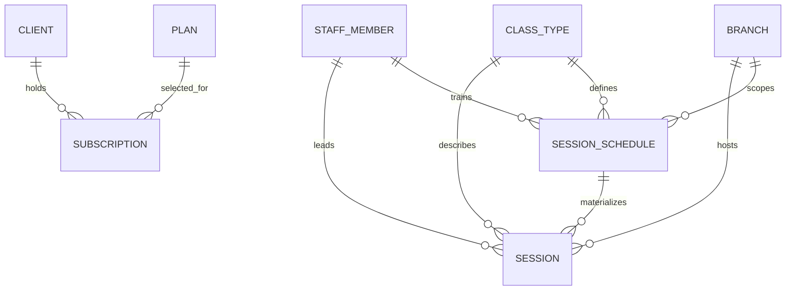

# BKM-001 — Booking & Membership schema proposal

Status: approved by the user on September 8, 2026, including the executable
review package and BKM-002 migration creation/testing on disposable databases.
This document itself creates no migration and does not alter the Prisma schema.

## Purpose and scope

This proposal adds the minimum Booking & Membership persistence needed to show
real catalog, schedule, subscription, and promotion data in the Client app and
to manage that data from the future admin web application.

The existing foundation already owns `clients`, `staff_members`, `branches`,
and `staff_branch_assignments`. This proposal adds only:

- Plans;
- Class Types;
- weekly Session Schedules and concrete Sessions;
- Subscriptions; and
- Promotions.

It deliberately does **not** add Bookings, Waitlists, Attendance, Payments,
Credits, Referrals, nutritionist Availability Blocks, Evaluation Slots, or
Evaluations. Those tables need their own workflow and concurrency decisions in
`BOOK-001` and `PAY-001`.

## Ownership and relationships

All tables in this proposal belong to the `booking` PostgreSQL schema. `Account`
continues to belong to `system`; Client and Staff Member identities stay in
`booking`. Plans and Subscriptions are studio-wide. Branches scope schedules
and Sessions, while a Client can browse and book at any Branch.

`Promotion` is intentionally independent: it is informational client-home
content, not a discount or a Plan relationship. Its optional image reference
uses the already-approved `system.image_assets` metadata; image upload and
finalization remain `UPL-001` work.

## Proposed tables

### `plans`

The catalog definition a Client may purchase after their current Subscription
expires. A Plan is never an unlimited membership.

| Field | Type / constraint | Why it exists |
| --- | --- | --- |
| `id` | UUID primary key | Stable Plan identity. |
| `name` | non-empty text; unique among non-hidden Plans | Client and admin label, for example “Paquete de 8 clases”. |
| `duration_months` | small integer; one of 1, 3, 6, 12 | Defines the fixed Subscription date range. |
| `class_allowance` | positive integer | Number of class units granted. |
| `price_centavos` | non-negative integer | Exact BOB price under ADR-0082. |
| `display_order` | non-negative integer | Stable Client catalog order. |
| `hidden_at` | nullable timestamp | Reversibly removes a Plan from future purchases without rewriting Subscription history. |
| `created_at`, `updated_at` | timestamps | Operational history. |

### `class_types`

The catalog definition from which Sessions are scheduled. It is not itself a
bookable occurrence.

| Field | Type / constraint | Why it exists |
| --- | --- | --- |
| `id` | UUID primary key | Stable Class Type identity. |
| `name` | non-empty text; unique among non-archived Class Types | Client-facing label, such as “Reformer Pilates”. |
| `description` | non-empty text | The short client-facing explanation shown on Session Detail. |
| `duration_minutes` | positive small integer | Determines concrete Session end time. |
| `default_capacity` | positive small integer | Normal capacity suggested to Session Schedules. |
| `equipment_needs` | nullable text | Human-readable equipment note only; it is not inventory. |
| `archived_at` | nullable timestamp | Stops future scheduling while preserving referenced history. |
| `created_at`, `updated_at` | timestamps | Operational history. |

### `session_schedules`

An Administrator-defined weekly pattern that the reconciler materializes into
concrete Sessions 30 days ahead. Editing a recurring pattern closes the old
row and creates a replacement row from an explicitly selected future date; it
does not rewrite the old row or booked occurrences.

| Field | Type / constraint | Why it exists |
| --- | --- | --- |
| `id` | UUID primary key | Stable source identity for materialized Sessions. |
| `branch_id` | required foreign key to `branches` | The single-room Branch that hosts the Sessions. |
| `class_type_id` | required foreign key to `class_types` | Class Type and duration source. |
| `trainer_staff_member_id` | required foreign key to `staff_members` | Assigned Trainer. Application validation requires the Trainer Role and Branch assignment. |
| `weekday` | ISO small integer from 1 through 7 | Bolivia weekday of the weekly pattern: Monday is 1 and Sunday is 7. |
| `starts_at_local` | time without time zone | Bolivia wall-clock start time; the business zone is fixed by ADR-0057. |
| `capacity` | positive small integer | Schedule-level override of the Class Type default. |
| `effective_from` | date | First local date this pattern can generate. |
| `effective_until` | nullable date; strictly after `effective_from` | Exclusive upper bound. Closing a schedule sets it to the replacement's `effective_from`, so the two definitions never overlap. |
| `created_at`, `updated_at` | timestamps | Operational history. |

There is no separate recurrence-rule table: the product has a weekly pattern,
not arbitrary recurrence syntax. There is also no Room reference because a
Branch has exactly one studio room.

### `sessions`

A durable, bookable occurrence. A Session stores the values needed to show and
operate that occurrence even when the source schedule later changes or closes.

| Field | Type / constraint | Why it exists |
| --- | --- | --- |
| `id` | UUID primary key | Stable occurrence identity for future Booking and Attendance records. |
| `session_schedule_id` | nullable foreign key to `session_schedules` | Source when materialized; nullable for an authorized one-off exception. |
| `branch_id` | required foreign key to `branches` | Host Branch, copied from the source for stable history and efficient reads. |
| `class_type_id` | required foreign key to `class_types` | Class Type, copied from the source for stable history and efficient reads. |
| `trainer_staff_member_id` | required foreign key to `staff_members` | Assigned Trainer for the occurrence. |
| `starts_at` | timezone-aware timestamp | Exact UTC instant, interpreted from Bolivia civil time. |
| `ends_at` | timezone-aware timestamp; after `starts_at` | Exact end instant. |
| `capacity` | positive small integer | Per-Session capacity; permits a rare one-off reduction. |
| `state` | `scheduled` or `cancelled` | Keeps cancelled occurrences in history rather than deleting them. |
| `is_exception` | boolean, default false | Makes a one-off Session or a changed generated occurrence explicit. |
| `cancellation_cause` | nullable `zero_bookings` or `no_substitute_trainer` | Distinguishes the automatic two-hour check from an Administrator's last-resort cancellation. Required exactly when cancelled. |
| `cancelled_at` | nullable timestamp | Required exactly when cancelled. |
| `cancelled_by_account_id` | nullable foreign key to `system.accounts` | Required only for `no_substitute_trainer`; must be null for the automatic `zero_bookings` cause. |
| `cancellation_note` | nullable text | Optional operational context. Neither cancellation flow requires free text. |
| `created_at`, `updated_at` | timestamps | Operational history. |

Required database protection:

- a unique `session_schedule_id` plus `starts_at` pair prevents duplicate
  materialization;
- an exclusion constraint prevents overlapping non-cancelled Sessions at the
  same Branch; and
- a second exclusion constraint prevents a Trainer from leading overlapping
  non-cancelled Sessions across Branches; and
- checks enforce the cancellation cause, timestamp, and actor rules for each
  state and cause.

The overlap constraints use PostgreSQL `btree_gist` for UUID equality combined
with timestamp ranges. `BKM-002` must create that extension explicitly in the
reviewed migration rather than assuming it is already installed.

The recurrence reconciler, not the database, decides which dates to materialize
and keeps the next 30 days available as required by ADR-0059.

### `subscriptions`

A Client's dated access to a Plan. It is separate from a Plan because it holds
the granted allowance and historical snapshot for that individual Client.

| Field | Type / constraint | Why it exists |
| --- | --- | --- |
| `id` | UUID primary key | Stable Subscription identity for later Bookings and Payments. |
| `client_id` | required foreign key to `clients` | Client who holds access. |
| `plan_id` | required foreign key to `plans` | Selected catalog Plan. |
| `plan_name_snapshot` | non-empty text | Historical Plan label if the catalog is later renamed. |
| `duration_months_snapshot` | one of 1, 3, 6, 12 | Historical date-range rule. |
| `original_class_allowance` | positive integer | Original granted units. |
| `remaining_class_allowance` | integer from 0 through `original_class_allowance` | Units remaining after future Booking operations. |
| `starts_on`, `ends_on` | dates; `ends_on` is not before `starts_on` | Paid access period in Bolivia civil time. |
| `state` | `active` or `expired` | Current status for Client UI and eligibility. |
| `activated_at`, `expired_at` | activation timestamp; nullable expiry timestamp | State-transition history. |
| `created_at`, `updated_at` | timestamps | Operational history. |

A partial unique index allows only one `active` Subscription per Client. Future
Booking rules will additionally decide whether zero allowance with booked future
Sessions remains active, as the glossary requires; that behavior belongs to
`BOOK-001`, not this schema proposal.

Both Subscription dates are inclusive Bolivia civil dates. `starts_on` is the
local date on which Payment confirmation activates the Subscription. `ends_on`
is the same calendar day after `duration_months_snapshot`, clamped to the last
day when the target month has no such date. For example, a one-month Subscription
starting January 31 is paid through February 28 in a non-leap year. Checks require
`activated_at`, require `expired_at` exactly when `state = expired`, and prohibit
an expired timestamp while `state = active`.

### `promotions`

Administrator-managed informational cards for the Client Home carousel. A
Promotion does not alter Plan price, Credit, or Payment behavior.

| Field | Type / constraint | Why it exists |
| --- | --- | --- |
| `id` | UUID primary key | Stable carousel record. |
| `headline` | non-empty text | Short client-facing title. |
| `description` | non-empty text | Supporting client-facing copy. |
| `image_asset_id` | nullable foreign key to `system.image_assets` | Artwork once `UPL-001` can finalize it; nullable while a draft is prepared. |
| `display_starts_on`, `display_ends_on` | dates; end is not before start | Inclusive Client display window in Bolivia civil time. |
| `display_order` | non-negative integer | Drag-reorder position in the carousel. |
| `published_at` | nullable timestamp | Current publication time; null means draft or unpublished. Re-publishing sets a new value. |
| `archived_at` | nullable timestamp | Retires the Promotion without deleting its record. An archived Promotion cannot be published. |
| `created_at`, `updated_at` | timestamps | Operational history. |

A database check requires an image for a published Promotion and prohibits an
archived Promotion from remaining published. Unpublishing clears `published_at`;
removing or replacing the image of a published Promotion first unpublishes it in
the same application transaction. Those transitions dispatch the public-variant
cleanup required by ADR-0077. Reads show only published, non-archived Promotions
whose display range contains the current Bolivia date. The reordering command
later normalizes `display_order` in one transaction; a unique order index would
make a simple drag swap unnecessarily fragile. Reads use `id` as a stable
tie-breaker when two records temporarily share an order.

## Foreign-key and retention policy

The tables in this proposal preserve business history rather than cascading
deletion:

- required references to Clients, Staff Members, Branches, Plans, Class Types,
  Session Schedules, and cancellation Accounts use restrictive deletion;
- referenced catalog and schedule rows are hidden, archived, or closed instead
  of deleted; and
- a Promotion's Image Asset uses restrictive deletion. The owning workflow must
  unpublish and detach it before the image cleanup process may delete the asset.

No foreign key in this proposal cascades deletion into historical records.

## Migration impact for approval

If approved, `BKM-002` will add the required `booking` enums, models, indexes,
checks, and foreign keys in one reviewed migration:

1. `plans`, `class_types`, `session_schedules`, `sessions`, `subscriptions`,
   and `promotions` only.
2. Foreign keys to the existing Booking foundation and approved System Image
   Asset/Account records; no new system or back-office tables.
3. No seed data, no runtime schema push, and no automatic creation of Plans,
   Sessions, Subscriptions, or Promotions.
4. No Booking allocation, Payment activation, recurring-materialization job,
   cancellation endpoint, upload behavior, or Client API. Those are later
   backlog items with their own tests and explicit approval gates.

## Approval requested

The exact Prisma models, generated SQL, additional PostgreSQL constraints,
representative rows, and executable review checks are now available in the
[schema review package](./BKM-001-schema-review-package.md), evidence `ce330db`.

Approval now requested: accept this proposal and that concrete review package
for `BKM-002`, including creating the application migration and testing it on
disposable databases. Applying it to the user's development database or
production remains a separate operational action.
