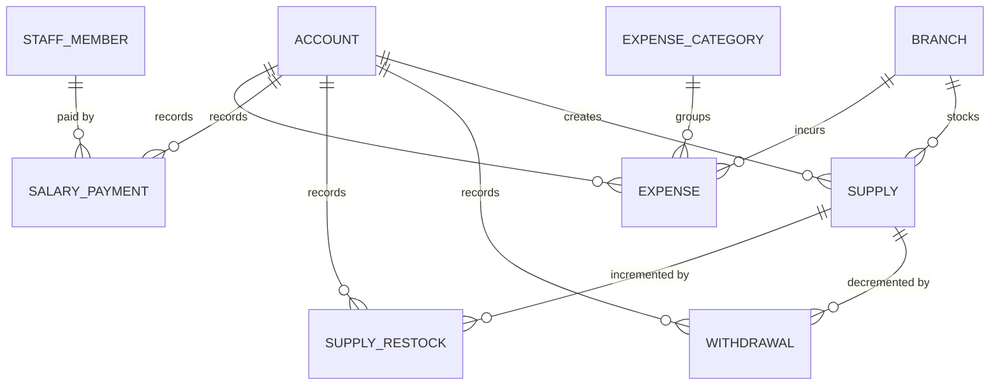

# BKO-001 — Back Office schema proposal

Status: **approved 2026-09-23 as proposed.** The user approved this proposal
and the migration review package as they stand, which accepts decisions
D1–D20, the new Restock movement, and the provisional answers to
[open questions](#open-questions) Q1–Q4. BKO-002 may create the migration and
the implementation. The exact Prisma models and SQL are in the
[BKO-001 migration review package](./BKO-001-migration-review.md).

This refines the five "Proposed" `back_office` rows of the
[full release schema proposal](./full-release-schema-proposal.md). It follows
the [Back Office language](../../back-office/CONTEXT.md), the
[Context Map](../../CONTEXT-MAP.md) relationships (Supply and Expense scoped to
a Branch, Salary Payment referencing a Staff Member, the cross-context income
and expense report), and the admin-web prompts
[AW08](../design/prompts/admin-web/08-insumos.md)–[AW16](../design/prompts/admin-web/16-reporte.md)
and [AW31](../design/prompts/admin-web/31-retiros-consumo.md). It does not
create a migration, change a Prisma model, write code, or change a design
prompt or anything under `design/`.

## Scope

BKO-002 would add six tables to the `back_office` PostgreSQL schema, which is
already listed in `schema.prisma` but not yet created by any migration:

1. `supplies` — a Branch's consumable item with its quantity on hand and
   low-stock threshold;
2. `withdrawals` — units taken out of a Branch's storage;
3. `supply_restocks` — units put into a Branch's storage (new, see D5);
4. `salary_payments` — a record that a Staff Member was paid;
5. `expense_categories` — Administrator-managed Expense labels; and
6. `expenses` — a Branch's recorded cost.

No `system` or `booking` table changes. Idempotency, audit, and Accounts stay
System Identity infrastructure reached through its public ports, as in
PAY-001, NUT-001, and ADM-001.

## Ownership and vocabulary

All six tables belong to **Back Office**. BKO-002 adds a top-level Back Office
NestJS module (ADR-0005) with its own repository adapters. Back Office never
writes a `booking` table: it references `booking.branches` and
`booking.staff_members` by foreign key and validates them (active Branch,
existing Staff Member) through a read-only Booking & Membership query, as
ADR-0011 allows.

- A **Supply** is one consumable item at one Branch. Its **quantity on hand** is
  a count of whole units maintained by the database from its movements.
- A **Withdrawal** takes units out and decrements the quantity on hand. It is
  logged at the moment the item is taken, never inferred from a recount.
- A **Restock** (proposed term, UI "Reposición") puts units in and increments
  the quantity on hand. See D5.
- A **Salary Payment** records that a Staff Member was paid an amount on a
  date. It is studio-wide, never Branch-scoped.
- An **Expense** records a Branch's cost with an amount, a date, and exactly
  one **Expense Category**.

## Decisions

Every row is a decision taken under the blanket backlog-decision approval.

| # | Decision | Rationale |
| --- | --- | --- |
| D1 | Six tables in `back_office`; foreign keys to `booking.branches`, `booking.staff_members`, and `system.accounts` are `ON DELETE RESTRICT`. The migration also runs `CREATE SCHEMA IF NOT EXISTS back_office`. | ADR-0011 schema per context; `booking` already references `system.accounts` the same way. Branches, Staff Members, and Accounts are never deleted (archival, deactivation), so the restriction only protects history. |
| D2 | **Administrator only**, for every command and read. `recorded_by_account_id` stores the acting Account. | CONTEXT-MAP calls Back Office admin-only, and every Back Office screen is admin web. The glossary's "recorded explicitly by staff" is read as the Administrator in v1. Letting Assistants record Withdrawals later needs no migration. |
| D3 | Supply quantities are **whole units** (`integer`), with no unit-of-measure column. | AW31 totals in "unid."; toilet paper and cleaning products are counted by package. |
| D4 | The **database maintains the stock**: `initial_quantity` is fixed at creation, and `quantity_on_hand` changes only through the Withdrawal and Restock insert triggers, which take the Supply's row lock. `quantity_on_hand >= 0` is a check. So `quantity_on_hand = initial_quantity + Σ restocks − Σ withdrawals` always holds, and stock can never go negative. | AW09 shows stock as read-only after creation ("day-to-day changes happen through Record Withdrawal"). A counter changed only by movements keeps concurrent Withdrawals from losing an update and makes the history reconcile. |
| D5 | **Add Restock** (`supply_restocks`): a positive number of units added to a Supply by an Administrator, with the time. It carries no money; buying the supplies is an Expense if the Administrator records one. Needs a glossary entry and a design follow-up (below). | The glossary and AW08–AW10 only ever decrease stock, and AW09 forbids editing it. Without a way to add units, every Supply would run down to zero and stay there. A separate, immutable movement keeps D4's reconciliation. Letting an edit overwrite the quantity was rejected because it would break the reconciliation and contradict AW09. |
| D6 | Withdrawals and Restocks are **immutable and never deleted**; there is no void in v1. An over-recorded Withdrawal can be offset with a Restock, which fixes the stock but leaves the month's consumption overstated. | AW31 is read-only and AW10 is a two-field fast entry with no correction path. A void is an additive change later if mistakes turn out to be common. |
| D7 | A Withdrawal's or Restock's time is its **recording instant** (`recorded_at`); there is no user-entered date. Monthly consumption uses the Bolivia month of `recorded_at`. | Glossary: logged "at the moment of taking the item". ADR-0057 Bolivia time. |
| D8 | **Low stock is derived**: `quantity_on_hand <= low_stock_threshold`, and never stored. The only alert is AW08's "Stock bajo" badge; no notification in v1. | AW08 and AW09 say "at or below"; the glossary's "falling below a threshold" is read the same way (a threshold of 0 flags only an empty Supply). No low-stock notification type, destination, or screen exists. |
| D9 | A Supply's **name and threshold are editable**; its Branch and initial quantity are not. Active names are unique per Branch, ignoring case and surrounding spaces (`lower(btrim(name))`, like Plans and Class Types). Supplies are never deleted; `archived_at` is a one-way archive that hides the Supply from AW08 and AW10, keeps its history in AW31, frees its name, and makes further movements fail. | A discontinued item would otherwise stay in the list forever. Archival rather than deletion keeps the Withdrawal history that AW31 reports. |
| D10 | A **Salary Payment** references one Staff Member of any Role, including a deactivated one; its amount is in centavos and its date is a Bolivia civil date (`paid_on`). Staff Member, amount, and date are editable (AW12's edit frame). | Glossary: amount and date only, not Branch-scoped. A final payment after someone leaves must be recordable. |
| D11 | An **Expense** takes its Branch from the top-bar selector at creation, and the Branch is immutable. Category, amount, and date (`incurred_on`) are editable (AW14's edit frame). | AW14 has no Branch field. Moving an Expense between Branches is a correction question (Q1), not an edit. |
| D12 | Salary Payment and Expense amounts are **positive** (`> 0`), stricter than ADR-0082's non-negative default. | A zero-amount payment or cost records nothing and would only add noise to AW11, AW13, and AW16. The check is easy to relax if a real zero case appears. |
| D13 | **Expense Categories** are studio-wide labels with a unique name ignoring case and surrounding spaces. v1 offers create and delete only (AW15 has no rename). Delete is refused while any Expense references it (`409 expense_category_in_use`, enforced by a restrictive foreign key). An unreferenced category is deleted outright. | AW15: "delete icon only enabled if no Expense currently references it". A label with no references has no history to keep. |
| D14 | New Supplies, movements, and Expenses require an **active (non-archived) Branch**. Back Office records do not block Branch archival; ADM-001's `branch_in_use` guard is unchanged. | Archival stops new activity and keeps history, as for Sessions and Availability Blocks. |
| D15 | Back Office uses **Read Committed**. A Withdrawal or Restock is one INSERT whose trigger updates the Supply under its row lock, so concurrent Withdrawals serialize on that row and the one that would go below zero fails the check. Salary Payments and Expenses are single-row writes. | ADR-0056 reserves Serializable for multi-row allocation and money transitions. The row lock already makes the stock change atomic; this was checked with two concurrent sessions during review. The full release proposal's "Serializable for Supply Withdrawal" note is superseded. |
| D16 | `Idempotency-Key` is required on **POST Withdrawal, Restock, Salary Payment, and Expense**. It is not required on Supply or Expense Category creation (unique names already reject a duplicate) or on edits. | ADR-0060: a lost response to a retried Withdrawal would decrement stock twice, and a retried payment or Expense would double-count money. |
| D17 | **Audited**: `salary_payment.recorded`, `salary_payment.updated`, `expense.recorded`, `expense.updated`, with the amount, date, and on update the previous values; Expense records carry their Branch. **Not audited**: Supplies, Withdrawals, Restocks, and Expense Categories. BKO-002 adds the catalog rows when it writes the codes, because the audit catalog sync check fails on a catalogued code that is never written. | ADR-0055 covers sensitive financial mutations. Stock rows already carry actor and time and move no money; categories are labels. |
| D18 | Timestamps default to `now()`, but the application writes `created_at` and `recorded_at` from its injected clock, and **no check compares a column default with an application-written instant**. | This is the fixture-clock failure fixed after ADM-001 (`idempotency_records_valid_lifetime_check`), avoided by design here. |
| D19 | Admin tables use page-and-offset pagination (default 20, max 100), most recent first, with allowlisted filters (ADR-0061/0062): Supplies by `branchId`; Withdrawals by `branchId`, Bolivia `month`, and optional `supplyId`, with per-Supply monthly totals (AW31); Salary Payments by optional `staffMemberId`, `from`, and `to`; Expenses by `branchId`, optional `expenseCategoryId`, `from`, and `to`. | Mirrors ADM-001 list conventions. |
| D20 | Table names follow the full release proposal (`withdrawals`, not `supply_withdrawals`). The migration would be `20260924000000_back_office`. | Consistency with the existing proposal; sorts after `20260923010100`. |

## Relationship diagram

`BRANCH` and `STAFF_MEMBER` are `booking` tables; `ACCOUNT` is `system`.

## Proposed tables

Names follow the existing conventions: UUID primary keys, `camelCase` Prisma
fields mapped to `snake_case` columns, `timestamptz(3)` instants, `date` for
Bolivia civil dates, integer BOB centavos, and restrictive foreign keys.

### `supplies`

| Field | Type / constraint | Purpose |
| --- | --- | --- |
| `id` | UUID primary key | |
| `branch_id` | FK → `booking.branches`, immutable | Owning Branch. |
| `name` | text, not blank | "Papel higiénico". Unique per Branch among active Supplies, ignoring case and surrounding spaces. |
| `initial_quantity` | integer `>= 0`, immutable | Stock entered on AW09 at creation. |
| `quantity_on_hand` | integer `>= 0`; equals `initial_quantity` on insert; changed only by movement triggers | Current stock (D4). |
| `low_stock_threshold` | integer `>= 0` | "Umbral de alerta" (D8). |
| `created_by_account_id` | FK → `system.accounts`, immutable | Administrator who created it. |
| `created_at`, `updated_at` | `timestamptz(3)` | `updated_at` tracks the Supply's own edits, not stock movements. |
| `archived_at` | nullable `timestamptz(3)`, set once | One-way archive (D9). |

Indexes: `branch_id`; partial unique `(branch_id, lower(btrim(name))) WHERE
archived_at IS NULL`; `created_by_account_id`. Rows are never deleted.

### `withdrawals` and `supply_restocks`

Both have the same shape:

| Field | Type / constraint | Purpose |
| --- | --- | --- |
| `id` | UUID primary key | |
| `supply_id` | FK → `back_office.supplies` | Supply moved; must not be archived. |
| `quantity` | integer `> 0` | Units taken out (Withdrawal) or put in (Restock). |
| `recorded_by_account_id` | FK → `system.accounts` | Administrator who logged it. |
| `recorded_at` | `timestamptz(3)` | Moment of the movement (D7). |

Indexes: `(supply_id, recorded_at)` for AW31's per-Supply month and the Supply
history; `withdrawals.recorded_at` for the Branch-wide month scan (joined to
`supplies.branch_id`); the actor column. An AFTER INSERT trigger applies the
movement to the Supply (D4); rows are immutable and never deleted (D6).

### `salary_payments`

| Field | Type / constraint | Purpose |
| --- | --- | --- |
| `id` | UUID primary key | |
| `staff_member_id` | FK → `booking.staff_members`, editable | "Empleado". |
| `amount_centavos` | integer `> 0`, editable | "Monto" (D12). |
| `paid_on` | `date`, editable | "Fecha", a Bolivia civil date. |
| `recorded_by_account_id` | FK → `system.accounts`, immutable | Administrator who recorded it. |
| `created_at`, `updated_at` | `timestamptz(3)`, `created_at` immutable | |

Indexes: `paid_on` for the report and AW11's order; `(staff_member_id,
paid_on)` for a per-person filter; the actor column. Rows are not deleted
(provisional answer to Q1).

### `expense_categories`

| Field | Type / constraint | Purpose |
| --- | --- | --- |
| `id` | UUID primary key | |
| `name` | text, not blank, unique by `lower(btrim(name))` | "Mantenimiento". |
| `created_at`, `updated_at` | `timestamptz(3)` | |

### `expenses`

| Field | Type / constraint | Purpose |
| --- | --- | --- |
| `id` | UUID primary key | |
| `branch_id` | FK → `booking.branches`, immutable | Branch the cost belongs to (D11). |
| `expense_category_id` | FK → `back_office.expense_categories` (`RESTRICT`), editable | "Categoría". |
| `amount_centavos` | integer `> 0`, editable | "Monto" (D12). |
| `incurred_on` | `date`, editable | "Fecha", a Bolivia civil date. |
| `recorded_by_account_id` | FK → `system.accounts`, immutable | Administrator who recorded it. |
| `created_at`, `updated_at` | `timestamptz(3)`, `created_at` immutable | |

Indexes: `(branch_id, incurred_on)` for AW13 and the single-Branch report;
`incurred_on` for the all-Branches report; `expense_category_id` for AW16's
breakdown and the category delete guard; the actor column. Rows are not
deleted (provisional answer to Q1).

## Database protections

The exact SQL is
[`sql/back-office-constraints.sql`](./sql/back-office-constraints.sql). In
summary:

- **Supplies**: non-blank name; non-negative initial quantity, quantity on
  hand, and threshold; the quantity on hand starts at the initial quantity;
  Branch, initial quantity, creator, and creation time are immutable; the
  quantity on hand changes only from a movement trigger; archival is one-way;
  never deleted.
- **Movements**: positive quantity; inserting one adjusts the Supply under its
  row lock, and fails if the Supply is archived or the stock would go
  negative; immutable and never deleted.
- **Salary Payments and Expenses**: positive amount; recorder and creation time
  immutable; an Expense's Branch immutable; not deleted (provisional, Q1).
- **Expense Categories**: non-blank, unique normalized name; deletion refused
  while referenced.

Authorization, active-Branch and Staff Member validation, date bounds (Q2),
idempotency, audit, and pagination are use-case rules.

## Commands and API direction for BKO-002

All under `/api/v1/administrator/…`, Administrator only, `no-store`, RFC 9457
errors with snake_case codes, and added to the admin-web-only compatibility
exemptions (BE-003).

| Screen | Endpoint sketch | Notes |
| --- | --- | --- |
| AW08 | `GET /supplies?branchId` | Name, quantity on hand, threshold, derived `lowStock`. |
| AW09 | `POST /supplies`, `PUT /supplies/{id}`, `POST /supplies/{id}/archival` | `409 supply_name_taken`; archive per D9 (needs a design follow-up). |
| AW10 | `POST /supplies/{id}/withdrawals` (Idempotency-Key) | `409 insufficient_stock` from the check, `409 supply_archived`. Returns the new quantity on hand. |
| Restock | `POST /supplies/{id}/restocks` (Idempotency-Key) | D5; needs a design follow-up. |
| AW31 | `GET /withdrawals?branchId&month&supplyId` | Rows plus per-Supply totals for the Bolivia month. |
| AW11/AW12 | `GET /salary-payments`, `POST` (Idempotency-Key), `PUT /salary-payments/{id}` | Audited (D17). |
| AW13/AW14 | `GET /expenses?branchId…`, `POST` (Idempotency-Key), `PUT /expenses/{id}` | Audited (D17). |
| AW15 | `GET /expense-categories`, `POST`, `DELETE /expense-categories/{id}` | `409 expense_category_name_taken`, `409 expense_category_in_use`. |
| AW16 | `GET /reports/expenses?from&to&branchId?` | Expense totals by Bolivia month and by Category, plus Salary Payment totals as Q3 decides. WEB-009 combines this with ADM-001's income report. |

## Representative rows

Readable identifiers stand in for UUIDs; amounts are centavos.

| Event | Resulting rows |
| --- | --- |
| Paola creates "Papel higiénico" at Centro with 10 units and threshold 4 | `supplies(id=papelCentro, branch=centro, initial_quantity=10, quantity_on_hand=10, low_stock_threshold=4, created_by=paola)`. AW08 shows no badge. |
| Paola withdraws 3 | `withdrawals(supply=papelCentro, quantity=3, recorded_by=paola, recorded_at=2026-09-24T14:10Z)`; `quantity_on_hand=7`. |
| Two withdrawals of 6 arrive at once | The first commits (`quantity_on_hand=1`, badge shown); the second waits on the Supply row, fails `supplies_values_check`, and answers `409 insufficient_stock`; no row is written. |
| Paola restocks 12 | `supply_restocks(supply=papelCentro, quantity=12)`; `quantity_on_hand=13` = 10 + 12 − 3 − 6. |
| AW31 for Centro, September 2026 | "2 retiros en septiembre de 2026", "Papel higiénico: 9 unid.". |
| Paola records Emma's pay of Bs 3 500 on 30 Sep | `salary_payments(staff_member=emma, amount_centavos=350000, paid_on=2026-09-30, recorded_by=paola)`; audit `salary_payment.recorded {amountCentavos: 350000, paidOn: 2026-09-30}`. |
| Paola corrects it to Bs 3 600 | `amount_centavos=360000`; audit `salary_payment.updated {previousAmountCentavos: 350000, amountCentavos: 360000}`. |
| A Bs 450.50 repair at Centro on 15 Sep | `expenses(branch=centro, expense_category=reparacion, amount_centavos=45050, incurred_on=2026-09-15)`; audit `expense.recorded`, Branch Centro. |
| Paola deletes "Reparación" | Refused `409 expense_category_in_use`. Deleting an unused "Limpieza" removes the row. |
| Centro's "Detergente" is discontinued | `archived_at` set; it leaves AW08 and AW10, its Withdrawals stay in AW31, and a new "Detergente" can be created at Centro. |

## Migration impact and rollout

- **One additive migration** `20260924000000_back_office`: create the
  `back_office` schema and six tables with their indexes, checks, and triggers,
  and add reverse relations on `Branch`, `StaffMember`, and `Account` in
  Prisma. There are no drops, backfills, seeds, enum changes, or pg-boss
  queues, and no existing column or constraint changes. The review package's
  generated SQL leaves out the known raw composite-key drift, as every earlier
  migration does.
- Expand-only and compatible with the running API and worker (ADR-0078): no
  deployed code reads `back_office`.
- Applied locally only to `pilates_test_*` databases and `pilates_dev_sim`,
  never to `emma_pilates`, shared development, or production outside the
  staged process.
- Rollback before any data exists: `DROP SCHEMA back_office CASCADE`, then
  `prisma migrate resolve --rolled-back`. After real data exists, recovery is a
  forward migration (ADR-0078).
- Delivery order for BKO-002 after approval: migration with the schema
  integration spec (rejection cases and the approved-table allowlist in
  `foundation-schema.integration-spec.ts`) → Back Office module and
  repositories → use cases with authorization, idempotency, and audit →
  controllers, contract regeneration, and compatibility exemptions →
  development fixtures (a few Supplies, categories, Expenses, and Salary
  Payments on `pilates_dev_sim`) → testing guide.

## Test plan

- **Rejection cases**: the review test's 32 expected failures (run on a
  disposable database during this review), promoted to a
  `back-office-schema.integration-spec.ts` fixture in BKO-002, as NUT-002 did.
- **Concurrency on real PostgreSQL**: two Withdrawals that together exceed
  stock (one wins, one `insufficient_stock`, stock never negative); a
  Withdrawal racing a Restock; a Withdrawal racing archival; the idempotent
  first execution, exact replay, conflicting reuse, and concurrent same-key
  submission for each of the four keyed commands.
- **Reads**: AW31 month boundaries at Bolivia midnight (a Withdrawal at
  2026-10-01T03:30Z counts for September); low-stock at, below, and above the
  threshold; pagination and filter allowlists; report sums by Bolivia month
  and Category, single Branch and all Branches.
- **Use cases and contract**: every command allowed for an Administrator and
  denied for the other Roles and anonymous callers; archived-Branch and
  unknown-Staff-Member rejections; audit rows written in the same transaction
  as the change; RFC 9457 codes; admin-web-only compatibility exemptions.

## Required follow-ups

- **Glossary** (`back-office/CONTEXT.md`), once approved: add **Restock**
  (_Avoid_: Replenishment, Stock movement, Recount); state that
  low stock is "at or below" the threshold; state that Withdrawals and
  Restocks are immutable.
- **Design follow-ups** (new files under `docs/design/prompts/followups/`,
  never edits to `design/` or to sent prompts), before WEB-007 builds the
  affected frames:
  1. AW08 — a "Registrar reposición" action next to "Registrar retiro", opening
     an AW10-style panel (Insumo, Cantidad repuesta, Registrar).
  2. AW09 — an "Archivar insumo" action in the edit frame, with a confirmation
     that the history stays in "Retiros e insumos consumidos".
  3. AW10 — the quantity field cannot exceed the stock shown, and the
     insufficient-stock error copy.
  4. AW16 — whatever Q3 decides about Salary Payments in a single-Branch view.

## Deliberately excluded

- Units of measure, fractional quantities, and per-unit costs (D3, D5).
- Recount-based stock adjustments (the glossary rules them out) and Withdrawal
  voids (D6).
- Low-stock notifications (D8).
- Expense descriptions or receipt images: AW14 has no such field; a nullable
  column is an easy later addition.
- How a salary amount is calculated (glossary: entirely outside the system).
- Assistant access to any Back Office action (D2).
- Report summary tables: reports query the authoritative rows.

## Open questions

These rules are the user's call (money and data governance). Each has a
provisional answer that the review package implements, so approving it as-is
accepts the provisional answers.

1. **Q1 — Correcting or removing money records.** May an Administrator delete
   or void a Salary Payment or Expense, for example one entered twice or at the
   wrong Branch? Options: (a) **provisional**: no deletion; amount, date, and
   Staff Member or Category can be edited with an audit record, and a duplicate
   can only be edited, not removed; (b) hard delete with an audit record that
   keeps the amount, date, and target; (c) void with `voided_at`,
   `voided_by_account_id`, and a reason, excluded from lists and totals. The
   review package's two delete-guard triggers encode (a); (b) drops them and
   (c) adds three columns.
2. **Q2 — Date bounds.** May `paid_on` or `incurred_on` be a future date, and
   should past months be locked (for example after taxes are declared)?
   **Provisional**: any date up to today in Bolivia, no lock. This is a
   use-case rule with no schema impact.
3. **Q3 — Salary Payments in a single-Branch report (AW16).** Options:
   (a) **provisional**: Salary Payments appear only in "Todas las sucursales";
   a single-Branch report's Gastos are that Branch's Expenses, the same way
   transfer income appears only studio-wide (CONTEXT-MAP); (b) include the
   full pay of every Staff Member assigned to the Branch, which counts the same
   payment under several Branches (the glossary says no true per-Branch salary
   figure exists); (c) split by some ratio, which the data does not support.
   Schema-neutral.
4. **Q4 — Retention and personal data (BE-007).** How long must Salary Payments
   and Expenses be kept under Bolivian tax obligations, and does a departed
   Staff Member's pay history survive a personal-data deletion request?
   **Provisional**: kept indefinitely with restrictive foreign keys until
   BE-007 sets the policy.

## Governing sources

- [Back Office context](../../back-office/CONTEXT.md),
  [Context Map](../../CONTEXT-MAP.md),
  [Booking & Membership context](../../booking/CONTEXT.md) (Branch, Staff Member)
- [ADR-0005](../adr/0005-modular-monolith-decomposed-by-bounded-context.md),
  [ADR-0011](../adr/0011-use-postgresql-with-schema-per-bounded-context.md),
  [ADR-0054](../adr/0054-enforce-contextual-authorization-in-use-cases.md),
  [ADR-0055](../adr/0055-store-focused-audit-records-in-postgresql.md),
  [ADR-0056](../adr/0056-use-serializable-transactions-selectively.md),
  [ADR-0057](../adr/0057-use-bolivia-time-for-all-business-scheduling.md),
  [ADR-0060](../adr/0060-require-idempotency-keys-for-retry-sensitive-commands.md),
  [ADR-0061](../adr/0061-use-contextual-pagination-styles.md),
  [ADR-0062](../adr/0062-allowlist-collection-filters-and-sorts.md),
  [ADR-0078](../adr/0078-stage-production-database-migrations.md),
  [ADR-0082](../adr/0082-represent-money-as-bob-centavos.md)
- [Full release schema proposal](./full-release-schema-proposal.md),
  [ADM-001](./ADM-001-admin-api-proposal.md) (income report, list
  conventions), [audit event catalog](../security/audit-event-catalog.md)
- Prompts [AW08](../design/prompts/admin-web/08-insumos.md),
  [AW09](../design/prompts/admin-web/09-supply-form.md),
  [AW10](../design/prompts/admin-web/10-record-withdrawal.md),
  [AW11](../design/prompts/admin-web/11-nomina.md),
  [AW12](../design/prompts/admin-web/12-salary-payment-form.md),
  [AW13](../design/prompts/admin-web/13-gastos.md),
  [AW14](../design/prompts/admin-web/14-expense-form.md),
  [AW15](../design/prompts/admin-web/15-categorias-de-gasto.md),
  [AW16](../design/prompts/admin-web/16-reporte.md),
  [AW31](../design/prompts/admin-web/31-retiros-consumo.md), and follow-up
  [07](../design/prompts/followups/07-insumos-add-withdrawal-history-link.md)
