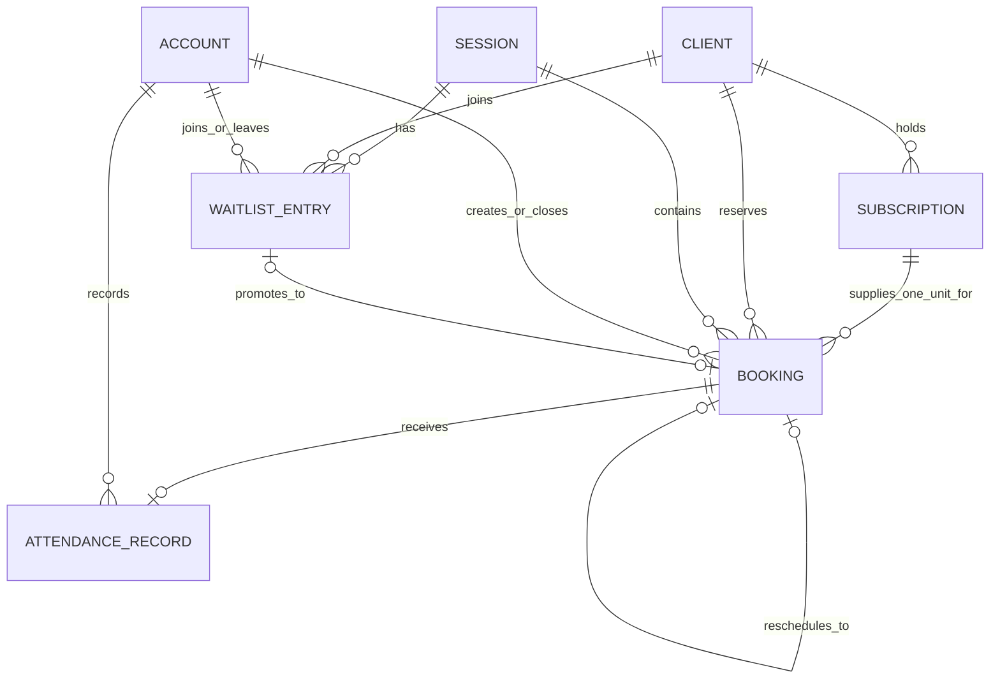

# BOOK-001 — Booking workflow schema proposal

Status: revised after review on September 9, 2026. This is a review document
only: it does not create a Prisma model, migration, endpoint, job, or seed data.

## Decision requested

Approve the three new Booking & Membership tables, one additional Session
processing field, and the command rules in this document. Approval would
authorize a separate, concrete SQL/Prisma review package and proposed migration
for `BOOK-002`; it does **not** authorize applying that migration to a normal
development or production database.

## Scope

`BKM-002` already provides the catalog and scheduling records: Plan, Class Type,
Session Schedule, Session, and Subscription. The Booking flow needs three new
Booking-owned tables:

1. `bookings` — a Client's reserved Session spot and its consumed Subscription
   unit;
2. `waitlist_entries` — an ordered request for a future Session spot; and
3. `attendance_records` — the Trainer's post-Session attended/no-show result.

The existing `sessions` table also needs one nullable
`empty_booking_check_completed_at` timestamp. It is the durable evidence that
the documented one-time empty-Session check ran, including when the Session was
not cancelled because it had a Booking.

No `booking_events`, capacity-counter, notification, job, queue, Room,
equipment, or idempotency table is proposed. Those would duplicate existing
responsibilities:

- `system.idempotency_records` protects retried Create Booking and Join Waitlist
  commands under ADR-0060;
- `system.audit_records`, `system.notifications`, and pg-boss remain system
  infrastructure; and
- a Session's existing `capacity`, `starts_at`, and `ends_at` remain
  authoritative.

## Relationship diagram

`Booking` keeps the Subscription that supplied its allowance. That lets a
cancellation return the unit to the exact Subscription that paid for the spot.

## Proposed tables

### `bookings`

A Booking is one Client's reserved spot in one concrete Session. It is never
deleted: cancellation or Reschedule changes its state so history and allowance
accounting remain explainable.

| Field | Type / constraint | Purpose |
| --- | --- | --- |
| `id` | UUID primary key | Stable Booking identity. |
| `session_id` | required FK → `booking.sessions` | The concrete reserved Session. |
| `client_id` | required FK → `booking.clients` | The Client attending. |
| `subscription_id` | required FK → `booking.subscriptions` | The Subscription unit consumed at Booking creation. |
| `state` | `booked`, `cancelled`, or `rescheduled` | Current outcome defined by the Booking glossary. |
| `created_by_account_id` | required FK → `system.accounts` | Client or Assistant actor who created it. |
| `created_at`, `updated_at` | timezone-aware timestamps | Creation and operational update time. |
| `cancelled_at` | nullable timezone-aware timestamp | Set only when `state = cancelled`. |
| `cancelled_by_account_id` | nullable FK → `system.accounts` | Client, Assistant, or Administrator actor. |
| `cancellation_cause` | nullable `client_request` or `session_cancelled` | Separates voluntary from studio cancellation; the actor distinguishes Client from Assistant. |
| `rescheduled_to_booking_id` | nullable, unique FK → `booking.bookings` | On the source Booking, points to its replacement. |
| `rescheduled_at` | nullable timezone-aware timestamp | Set only when `state = rescheduled`. |
| `rescheduled_by_account_id` | nullable FK → `system.accounts` | Client or Assistant actor who made the same-day move. |

A Reschedule creates a normal `booked` replacement using the same Client and
Subscription, then changes the source to `rescheduled` and links it through
`rescheduled_to_booking_id`. The target Session must differ. A replacement may
later be rescheduled again, forming a one-way chain without charging another
allowance unit.

### `waitlist_entries`

A Waitlist Entry is a Client's place in one full Session's ordered queue. It
does not reserve a spot and does not consume allowance.

| Field | Type / constraint | Purpose |
| --- | --- | --- |
| `id` | UUID primary key | Stable Entry identity. |
| `session_id` | required FK → `booking.sessions` | The full Session being waited for. |
| `client_id` | required FK → `booking.clients` | Client holding the queue position. |
| `joined_by_account_id` | required FK → `system.accounts` | Client or Assistant who joined it. |
| `joined_at` | timezone-aware timestamp | Queue order; `id` breaks a timestamp tie. |
| `closed_at` | nullable timezone-aware timestamp | Set when the Entry stops being active. |
| `closure_reason` | nullable `left`, `promoted`, `session_cancelled`, or `session_started` | Explains every terminal outcome. |
| `closed_by_account_id` | nullable FK → `system.accounts` | Client or Assistant actor; present only for `left`. |
| `promoted_booking_id` | nullable, unique FK → `booking.bookings` | Booking created by promotion; present only for `promoted`. |

An Entry is active when `closed_at` is null. Its order is always
`joined_at ASC, id ASC`; there is no mutable position column. Entries that
remain when a Session starts close with `session_started` and no notification.

### `attendance_records`

Attendance is one record per Booking, so `booking_id` is both primary key and
foreign key. A separate generated Attendance identifier adds no business value.

| Field | Type / constraint | Purpose |
| --- | --- | --- |
| `booking_id` | primary key and FK → `booking.bookings` | The booked Client whose Attendance is recorded. |
| `outcome` | `attended` or `no_show` | Assigned Trainer's result after the Session. |
| `recorded_by_account_id` | required FK → `system.accounts` | Authenticated Trainer Account that saved the roster. |
| `recorded_at` | timezone-aware timestamp | First complete roster save. |
| `updated_at` | timezone-aware timestamp | Latest correction time. |

The assigned Trainer must submit an outcome for every `booked` Booking in one
atomic roster save. The same assigned Trainer may later correct the complete
roster, with no arbitrary first-release deadline. A correction updates the
outcome and `updated_at`; previous values are not retained in a speculative
history table. Attendance never changes allowance, Subscription state, or
Booking state. Client class history reads only `attended` records.

## Database protections

The future migration must use restrictive foreign keys. Business records are
kept for history; none of these foreign keys cascade deletion.

| Protection | Reason |
| --- | --- |
| Partial unique `(session_id, client_id)` where Booking is `booked` | A Client cannot hold two live spots in one Session. |
| Partial unique `(session_id, client_id)` where a Waitlist Entry is active | A Client cannot join one Session's Waitlist twice. |
| Composite FK from Booking `(subscription_id, client_id)` | The consumed Subscription must belong to the booked Client. |
| Composite FK from promoted Entry `(promoted_booking_id, session_id, client_id)` | A promotion must create a Booking for the same Client and Session. |
| Composite self-FK from source `(rescheduled_to_booking_id, client_id, subscription_id)` | A Reschedule replacement must retain the Client and Subscription. |
| Unique `waitlist_entries.promoted_booking_id` | One Entry can create at most one Booking. |
| Unique `bookings.rescheduled_to_booking_id` | One replacement can have at most one direct predecessor. |
| Booking state checks | `cancelled` requires exactly its cancellation fields; `rescheduled` requires exactly its Reschedule fields and replacement; `booked` has neither terminal group. |
| Waitlist state checks | Active has no closure fields; `left` requires its actor; `promoted` requires its Booking; system closure reasons require neither. |
| Temporal checks | Booking terminal times cannot precede creation, Waitlist closure cannot precede joining, and Attendance update cannot precede its first recording. |
| Existing positive Session capacity check | Bookings cannot point to an impossible capacity value. |

The referenced composite keys require supporting unique keys on
`subscriptions (id, client_id)`, `bookings (id, session_id, client_id)`, and
`bookings (id, client_id, subscription_id)`. The migration should also add:

- active Bookings by Session for capacity counts;
- active Bookings by Client for overlap and future-Booking checks;
- Bookings by Subscription for expiration and allowance checks;
- active Waitlist entries by `(session_id, joined_at, id)` for promotion; and
- active Waitlist entries by Client for upcoming-list reads.

Capacity, cross-Branch Client overlap, a different Reschedule target Session,
complete Attendance rosters, and mutual exclusion between a live Booking and an
active Waitlist Entry cannot be safe single-row checks. The short transactions
below protect them and are covered by real concurrent PostgreSQL tests. Session
times are queried from their authoritative rows rather than copied into
`bookings` for an exclusion constraint.

## Authorization

Every use case resolves the current Account and applies default-deny contextual
authorization:

- a Client may create, join, leave, cancel, or Reschedule only their own record
  and may read only their own Bookings, Waitlist entries, and Attendance-backed
  history;
- an Assistant may act for any selected Client only at an assigned Branch;
  Reschedule requires assignment to both source and target Branches, and reads
  expose only records the requested operation permits;
- a Trainer may read the roster and record or correct Attendance only when their
  linked Staff Member is the Session's assigned Trainer; Trainers do not see the
  Waitlist;
- an Administrator may search and cancel eligible Sessions across all Branches;
  and
- promotion, expiration, empty checks, and Session-start finalization accept
  only internal worker/application authority, never a caller-supplied Role.

## Commands and transaction rules

All commands reload current state and use the PostgreSQL clock. Bolivia calendar
rules use `America/La_Paz`. Serializable isolation with bounded retries is used
only for allocation and coupled state changes under ADR-0056; deterministic
business conflicts are not retried. Transactions create durable follow-up work
but never send a notification or call a provider.

| Command | Isolation | Required state and atomic result |
| --- | --- | --- |
| Create Booking | Serializable | Session is scheduled and future. Before direct allocation, process any active queue while promotion is allowed. Capacity remains; Client has one active Subscription covering the Session's Bolivia date with allowance; no live Booking overlaps at any Branch; and no active Entry remains for this Client/Session. Insert `booked`, decrement that Subscription once, and store the idempotent response. Requires `Idempotency-Key`. |
| Join Waitlist | Serializable | Session is scheduled, future, full, and still more than 2 h 30 away. Client has an active Subscription covering its Bolivia date, but remaining allowance is not required. Client has no live Booking or active Entry for it. Insert only the Entry and idempotent response. Requires `Idempotency-Key`. |
| Leave Waitlist | Read Committed | Conditional update closes one active Entry as `left`; an already-closed Entry cannot transition again. No allowance changes. |
| Cancel Booking | Serializable | Booking and Session are live and the start is strictly more than 2 h 30 away. Mark the Booking `cancelled/client_request`, return exactly one unit to its linked Subscription, then promote in queue order while capacity and time permit. |
| Reschedule Booking | Serializable | Source is `booked` and at or inside 2 h 30 before start, but has not started. Target is a different scheduled future Session on the same Bolivia date. It has capacity after queue fairness, and it overlaps no other live Booking for the Client. Create the same-Client/same-Subscription target and change the source to `rescheduled`; allowance is unchanged. |
| Promote Waitlist | Serializable, inside the capacity-changing transaction | Before the Cancellation Window, inspect active Entries in order. Promote each first eligible Client while capacity remains. Eligibility requires an active Subscription covering the Session date with allowance and no overlapping live Booking. Skipped Clients stay queued. Each success inserts a Booking, decrements its exact Subscription, closes its Entry, and creates its durable notification. |
| Cancel Session | Serializable | Administrator targets a scheduled, future Session with at least one live Booking and confirms no substitute Trainer is available. Mark it `cancelled/no_substitute_trainer`; cancel all live Bookings as `session_cancelled`; refund every linked unit; close all active Entries as `session_cancelled`; create one Session audit record and all required Notifications. |
| Check empty Session | Serializable | At or after `starts_at - 2 hours`, handle a scheduled Session only when `empty_booking_check_completed_at` is null. If zero live Bookings exist, cancel it as `zero_bookings`, close active Entries as `session_cancelled`, and notify the assigned Trainer and queued Clients. Otherwise leave it scheduled. In both cases set the completion timestamp once. |
| Finalize Session start | Serializable | At or after start, close remaining active Entries as `session_started` without notification and re-evaluate affected zero-allowance Subscriptions. Duplicate work is a no-op. |
| Record or correct Attendance | Read Committed | Session has ended and is not cancelled. Authenticated Account is its assigned Trainer. Upsert one outcome for every `booked` Booking in a complete atomic roster; a retry with the same values is a no-op. |

At the exact `starts_at - 2 hours 30 minutes` boundary, free cancellation and
promotion are closed and Reschedule is open. Capacity-changing commands for one
Session serialize queue inspection in a consistent order. A cross-Session
Reschedule acquires any explicit Session locks in stable identifier order if the
repository needs locks in addition to Serializable isolation.

A future Session-capacity increase must use the same Serializable boundary,
must not reduce capacity below the live Booking count, and, while promotion is
still allowed, must process the existing Waitlist before exposing remaining
capacity to direct Booking. Inside the Cancellation Window it does not promote.

An authorized edit that changes a future Session's `starts_at` clears
`empty_booking_check_completed_at` in the same transaction. The reconciler then
runs the one-time check against the new due instant; stale work for the old
start becomes a successful no-op.

## Subscription allowance and expiration

Creating or promoting a Booking decrements only its linked Subscription with a
conditional non-negative update. Cancelling returns one unit only when the
Booking makes its one permitted transition to `cancelled`. Reschedule never
changes allowance.

Consuming the last unit does not immediately expire a Subscription while it has
a booked Session ahead. A Subscription expires when either:

- the Bolivia date is after its inclusive `ends_on`; or
- its allowance is zero and it has no `booked` Session whose start is still in
  the future.

An idempotent reconciler discovers active Subscriptions meeting either rule and
dispatches bounded internal jobs under ADR-0058. Session-start finalization also
re-evaluates the Subscriptions used by that Session so a Client is not left
unnecessarily unable to purchase their next Plan. Eligibility checks always
recheck dates and allowance rather than trusting a possibly stale state alone.
The existing three-day renewal reminder remains required but belongs to the
notification delivery slice, not to these three domain tables.

## Idempotency

Create Booking and Join Waitlist store their successful outcome in
`system.idempotency_records` in the same transaction as the business effect.
Exact replay returns that outcome; different input under the same
Account/command/key conflicts; concurrent use cannot execute twice. Rolled-back,
authorization, deterministic conflict, and exhausted transient failures are not
stored.

Leave, Cancel, Reschedule, Session cancellation, and Attendance address one
specific existing state transition and do not require a key under ADR-0060.
Their conditional writes make retries safe: a completed Reschedule returns its
linked replacement for equivalent retry input, and incompatible repeats return
a stable conflict rather than creating another effect. Worker jobs use stable
business keys plus authoritative-state rechecks instead of Account-scoped keys.

## Notifications, background jobs, and audit

Booking transactions call the owning System module's public interface rather
than writing another context's repository directly. Durable Notification rows
and any pg-boss delivery work commit with the successful business change;
provider delivery happens afterward and is idempotent.

Required notification events are:

- Waitlist promotion → promoted Client;
- Administrator Session cancellation → every booked Client, every active
  Waitlisted Client, and the assigned Trainer; and
- automatic empty-Session cancellation → assigned Trainer and any active
  Waitlisted Client.

No notification is created for an Entry closed because its Session started.
Routine Booking, Waitlist, promotion, automatic cancellation, and Attendance
activity is not separately audit-recorded: their business rows retain the
necessary actor and outcome. Administrator Session cancellation is a materially
important operational action and creates one append-only `system.audit_records`
row in the same transaction. It targets the Session and records the actor Role,
Branch, correlation identifier, cancellation cause, and aggregate affected and
refunded counts without copying Client details.

Reconcilers discover missing empty checks, due Subscription expirations, and
Session-start finalization from authoritative PostgreSQL state. Jobs carry only
stable identifiers plus the expected due instant or state version, recheck
applicability, use bounded internal-job retries, and turn stale or duplicate
work into a successful no-op. The Session completion marker prevents a later
drop to zero Bookings from changing the result of the documented one-time
two-hour check.

## Required tests

`BOOK-002` and `BOOK-003` must cover successful and denied authorization,
database rejection cases, exact time boundaries, and the following real
PostgreSQL races:

- Create Booking versus Create Booking, cancellation/promotion, capacity edit,
  and the empty check;
- Join Waitlist versus another join and cancellation;
- two concurrent promotion attempts;
- Reschedule versus target Booking and another Reschedule;
- the last allowance unit versus another Booking and Subscription expiration;
- Session cancellation versus Booking, promotion, and the empty check; and
- first execution, exact replay, conflicting reuse, and concurrent submission
  for each required idempotency key.

Attendance tests must cover incomplete-roster rejection, first complete save,
equivalent replay, correction by the assigned Trainer, denial for every other
Role or Trainer, cancelled Sessions, and pre-end attempts.

## Representative rows

These readable identifiers stand in for UUIDs; they are examples of eventual
stored state, not endpoints available today.

| Event | Resulting rows |
| --- | --- |
| Ana books Reformer on September 14 using her 8-class Subscription | `booking(id=bookingAna, session_id=reformerSep14, client_id=ana, subscription_id=anaPack8, state=booked, created_by_account_id=anaAccount)`; `anaPack8.remaining_class_allowance` changes 8 → 7. |
| Lucía finds that Session full | `waitlist_entries(id=waitLucia, session_id=reformerSep14, client_id=lucia, joined_by_account_id=luciaAccount, joined_at=2026-09-10T14:00:00Z, closed_at=null)`. Her allowance is unchanged. |
| Ana cancels before the window | `bookingAna.state=cancelled`, `cancellation_cause=client_request`; `anaPack8.remaining_class_allowance` changes 7 → 8. If Lucía remains eligible, her Entry closes as `promoted`, links `bookingLucia`, and that Booking consumes one of Lucía's units. |
| Ana reschedules during the window | `bookingAna.state=rescheduled`, its Reschedule fields point to new `bookingAnaLater.state=booked`, and both use `anaPack8`; allowance does not change. |
| Trainer records Ana attended | `attendance_records(booking_id=bookingAnaLater, outcome=attended, recorded_by_account_id=trainerMariaAccount, recorded_at=..., updated_at=...)`. |
| Full Session starts before Lucía is promoted | `waitLucia.closed_at` is set with `closure_reason=session_started`; no notification is created. |

## Explicit non-goals

- Payments, Subscription activation, Credit, Referral, receipt uploads, and
  Promotions stay outside this proposal.
- Session Schedule materialization is established in BKM-002; this proposal
  defines only the Booking-related due work that depends on it.
- Evaluation booking has different rules and needs `NUT-001`.
- No generic CRUD endpoints, configurable Roles, Room, Equipment inventory,
  cancellation fee, Attendance history table, or Reschedule outside the
  Cancellation Window is added.

## Approval impact

The concrete review artifacts are in the
[BOOK-001 schema review package](./BOOK-001-schema-review-package.md). They
remain documentation only until a later, explicit migration-creation approval.

If approved, the next design checkpoint will contain the exact Prisma fragment,
SQL migration, constraints, valid examples, rejected cases, and migration
impact summary for the three new tables, their enums, and the one Session field.
Only after that separate review will a migration be created or tested on a
disposable database.
