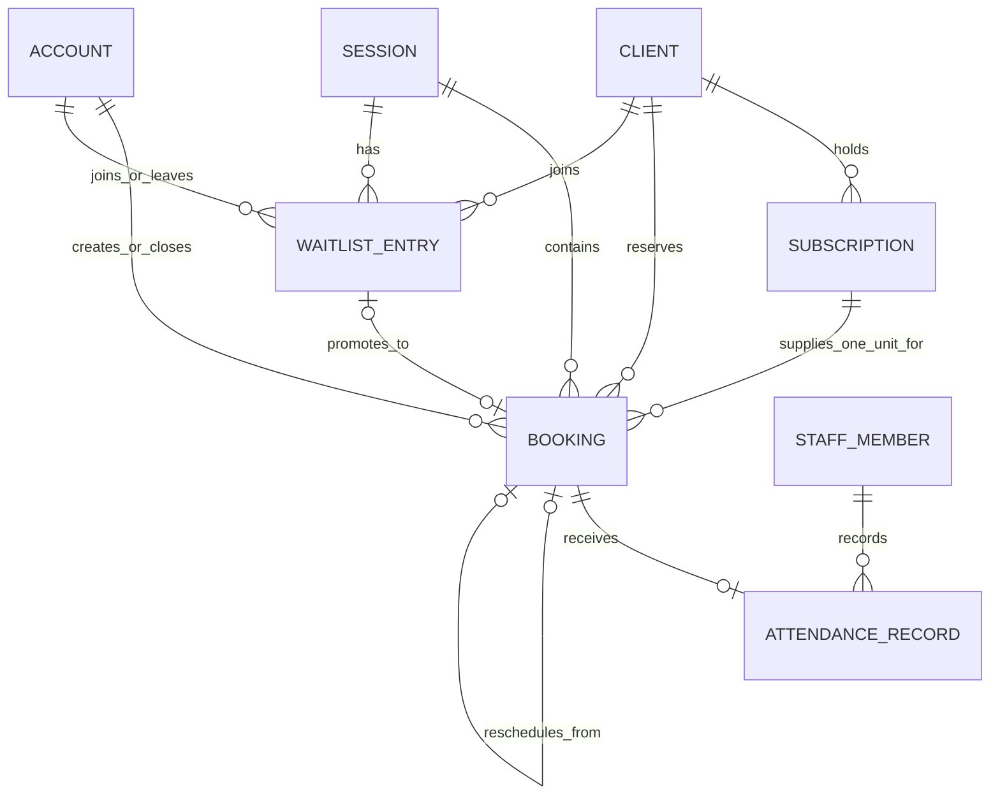

# BOOK-001 — Booking workflow schema proposal

Status: proposed on September 9, 2026. This is a review document only: it does
not create a Prisma model, migration, endpoint, job, or seed data.

## Decision requested

Approve the three Booking & Membership tables and the command rules in this
document. Approval would authorize a separate, concrete SQL/Prisma review
package and proposed migration for `BOOK-002`; it does **not** authorize applying
that migration to a normal development or production database.

## Scope

`BKM-002` already provides the catalog and scheduling records: Plan, Class Type,
Session Schedule, Session, and Subscription. The Booking flow needs only three
more Booking-owned tables:

1. `bookings` — a client's reserved Session spot and its consumed Subscription
   unit;
2. `waitlist_entries` — an ordered request for a future Session spot; and
3. `attendance_records` — the Trainer's post-Session attended/no-show result.

No `booking_events`, capacity-counter, notification, job, queue, Room,
equipment, or idempotency table is proposed. Those would duplicate existing
responsibilities:

- `system.idempotency_records` already protects a retried Booking or Waitlist
  command under ADR-0060;
- `system.audit_records`, `system.notifications`, and pg-boss remain system
  infrastructure; and
- a Session's existing `capacity`, `starts_at`, and `ends_at` are authoritative.

## Relationship diagram

`Booking` keeps the link to the Subscription that supplied its allowance. That
is what lets a cancellation return the unit to the original Subscription rather
than to whichever Plan happens to be on sale later.

## Proposed tables

### `bookings`

A Booking is one client's reserved spot in one concrete Session. It is never
deleted: a cancellation or Reschedule changes its state so client history and
allowance accounting stay explainable.

| Field | Type / constraint | Purpose |
| --- | --- | --- |
| `id` | UUID primary key | Stable Booking identity. |
| `session_id` | required FK → `booking.sessions` | The concrete reserved Session. |
| `client_id` | required FK → `booking.clients` | The Client attending. |
| `subscription_id` | required FK → `booking.subscriptions` | The Subscription unit consumed at Booking creation. |
| `status` | `booked`, `cancelled`, or `rescheduled` | Current outcome defined by the Booking glossary. |
| `created_by_account_id` | required FK → `system.accounts` | Distinguishes self-service from an Assistant acting for a Client without a second “source” table. |
| `created_at`, `updated_at` | timezone-aware timestamps | Creation and operational update time. |
| `cancelled_at` | nullable timezone-aware timestamp | Set only when `status = cancelled`. |
| `cancelled_by_account_id` | nullable FK → `system.accounts` | Actor for Client/Assistant cancellation or Administrator Session cancellation. |
| `cancellation_reason` | nullable `client`, `assistant`, or `session_cancelled` | Explains an allowance refund without guessing from the actor. |
| `rescheduled_from_booking_id` | nullable, unique FK → `booking.bookings` | On the replacement Booking, points to the earlier Booking it supersedes. |
| `rescheduled_at` | nullable timezone-aware timestamp | Set only when `status = rescheduled`. |
| `rescheduled_by_account_id` | nullable FK → `system.accounts` | Actor who made the same-day move. |

The replacement created by a Reschedule is a normal `booked` Booking. Its
`rescheduled_from_booking_id` points to the earlier Booking, which becomes
`rescheduled`. This preserves both Session records while charging no second
allowance unit.

### `waitlist_entries`

A Waitlist Entry is a Client's place in one full Session's ordered queue. It
does not reserve a spot and does not consume an allowance.

| Field | Type / constraint | Purpose |
| --- | --- | --- |
| `id` | UUID primary key | Stable queue entry identity. |
| `session_id` | required FK → `booking.sessions` | The full Session being waited for. |
| `client_id` | required FK → `booking.clients` | Client holding the queue position. |
| `joined_by_account_id` | required FK → `system.accounts` | Client or Assistant who joined it. |
| `joined_at` | timezone-aware timestamp | Queue order; `id` breaks a timestamp tie. |
| `closed_at` | nullable timezone-aware timestamp | Set when the Entry is left, promoted, or ends because its Session is cancelled. |
| `closure_reason` | nullable `left`, `promoted`, or `session_cancelled` | Explains why a former queue position is no longer active. |
| `closed_by_account_id` | nullable FK → `system.accounts` | Client or Assistant actor for a voluntary leave only. |
| `promoted_booking_id` | nullable, unique FK → `booking.bookings` | The Booking created by promotion. |

An Entry is active when `closed_at` is null. Its order is always `joined_at ASC,
id ASC`; there is no mutable position column to repair after a Client leaves or
is skipped.

### `attendance_records`

Attendance is deliberately one record per Booking, so `booking_id` is both the
primary key and foreign key. A separate generated attendance ID would add no
business value.

| Field | Type / constraint | Purpose |
| --- | --- | --- |
| `booking_id` | primary key and FK → `booking.bookings` | The booked Client whose attendance is being recorded. |
| `outcome` | `attended` or `no_show` | The Trainer's result after the Session. |
| `recorded_by_staff_member_id` | required FK → `booking.staff_members` | Trainer who recorded it. |
| `recorded_at` | timezone-aware timestamp | When the result was saved. |
| `updated_at` | timezone-aware timestamp | Standard operational update time. |

An Attendance Record never changes allowance, Subscription state, or Booking
status. Client class history reads only records with `outcome = attended`.
Whether a saved result may later be corrected is intentionally not decided by
this persistence proposal.

## Database protections

The future migration should use restrictive foreign keys. Business records are
kept for history; none of these foreign keys cascade deletion.

| Protection | Reason |
| --- | --- |
| Partial unique `(session_id, client_id)` where Booking is `booked` | A Client cannot hold two live spots in the same Session. |
| Partial unique `(session_id, client_id)` where a Waitlist Entry is active | A Client cannot join the same Session's Waitlist twice. |
| Unique `waitlist_entries.promoted_booking_id` | One queue entry can create at most one Booking. |
| Unique `bookings.rescheduled_from_booking_id` | One earlier Booking can have only one direct replacement. |
| Booking state checks | Cancellation fields exist only for `cancelled`; Reschedule fields exist only for `rescheduled`; an active Booking has neither. |
| Waitlist state checks | An Entry is either active, left, promoted, or ended by Session cancellation—never more than one at once. Its actor and promoted Booking are present only for the matching closure reason. |
| Positive Session capacity already exists | Bookings never create an impossible capacity value. |

Capacity and a Client's cross-Branch time overlap are not safe single-row
constraints because they depend on several Booking rows and the referenced
Session interval. They are protected by the short Serializable command
transactions required below, with real concurrent PostgreSQL tests. The
implementation queries the authoritative Session times; it does not copy a
second, potentially stale time range into `bookings` merely to force an
exclusion constraint.

## Commands and transaction rules

All listed commands reload current state, use `America/La_Paz` for business-date
rules, and run at Serializable isolation with the bounded retry policy in
ADR-0056. No transaction sends a notification or calls a provider.

| Command | Who may act | Required state and result |
| --- | --- | --- |
| Create Booking | Client for themselves; Assistant for a Client at an assigned Branch | Session is scheduled and future; its capacity is available; the Client has an eligible Subscription for the Session date with remaining allowance; no overlapping live Booking exists at any Branch. Insert `booked` Booking and decrement that exact Subscription once. Requires `Idempotency-Key`. |
| Join Waitlist | Client for themselves; Assistant for a Client at an assigned Branch | Session is scheduled, future, and full; Client has no live Booking or active Entry for it. Insert Entry only—no allowance change. Requires `Idempotency-Key`. The current glossary defines a promotion cutoff, not a queue-joining cutoff, so this proposal does not invent one. |
| Leave Waitlist | Client for themselves; Assistant for the Client at an assigned Branch | Active Entry closes with reason `left`. It never changes allowance. |
| Cancel Booking | Client for themselves; Assistant for a Client at an assigned Branch | Booking is live and more than 2 h 30 before Session start. Mark it cancelled, return one unit to its linked Subscription, then attempt Waitlist promotion if still before the window. |
| Reschedule Booking | Client for themselves; Assistant for a Client at an assigned Branch | Booking is live and inside the 2 h 30 Cancellation Window. Target is a different Session on the same Bolivia civil date, scheduled, future, and has capacity. Mark source rescheduled and create the linked target Booking; allowance does not change. |
| Promote Waitlist | System, inside a cancellation/reservation transaction | Pick active Entries in queue order while before the Cancellation Window. The first eligible Client gets a Booking and their exact Entry closes with reason `promoted`. Ineligible Clients remain queued and unmodified. Stop at the first point the Session is full or the window begins. |
| Cancel Session | Administrator, all Branches | Existing Session cancellation rule remains authoritative: mark the Session cancelled with `no_substitute_trainer`; cancel every live Booking with `session_cancelled`; return every linked unit; close every active Waitlist Entry with `session_cancelled`; create required audit and notification work in the same transaction. |
| Auto-cancel empty Session | Worker | At the one-time two-hour check, cancel a scheduled Session only when it has zero live Bookings. This is `zero_bookings`, so there are no Booking refunds. A reconciler and idempotent pg-boss job discover/recheck the due Session under ADR-0058. |
| Record Attendance | Assigned Trainer only | Session has ended, is not cancelled, and Booking is live. Insert or correct the one Attendance Record. |

`BOOK-002` must test successful and denied authorization paths, capacity races,
overlapping Session races, duplicate idempotency-key replay, concurrent
Waitlist joins, and allowance accounting against real PostgreSQL. `BOOK-003`
must add the cancellation, Reschedule, Waitlist-promotion, Attendance, and
exact 2 h 30 boundary coverage when it implements those commands.

## Representative rows

These readable identifiers stand in for UUIDs; they are examples of eventual
stored state, not endpoints available today.

| Event | Resulting rows |
| --- | --- |
| Ana books Reformer on September 14 using her 8-class Subscription | `booking(id=bookingAna, session_id=reformerSep14, client_id=ana, subscription_id=anaPack8, status=booked, created_by_account_id=anaAccount)`; `anaPack8.remaining_class_allowance` changes 8 → 7. |
| Lucía finds that Session full | `waitlist_entries(id=waitLucia, session_id=reformerSep14, client_id=lucia, joined_by_account_id=luciaAccount, joined_at=2026-09-10T14:00:00Z, closed_at=null)`. Her allowance is unchanged. |
| Ana cancels before the window | `bookingAna.status=cancelled`, `cancellation_reason=client`; `anaPack8.remaining_class_allowance` changes 7 → 8. If Lucía remains eligible, `waitLucia.closed_at` and `closure_reason=promoted` plus `promoted_booking_id=bookingLucia` are set and `bookingLucia` consumes one of Lucía's units. |
| Ana reschedules during the window | `bookingAna.status=rescheduled`, `rescheduled_at` and actor set; new `bookingAnaLater.status=booked`, `rescheduled_from_booking_id=bookingAna`. `anaPack8.remaining_class_allowance` does not change. |
| Trainer records Ana attended | `attendance_records(booking_id=bookingAnaLater, outcome=attended, recorded_by_staff_member_id=trainerMaria, recorded_at=...)`. |

## Explicit non-goals

- Payments, Subscription activation, Credit, Referral, receipt uploads, and
  Promotions stay outside this proposal.
- Session Schedule materialization is already established in BKM-002; the
  recurring worker implementation is not added here.
- Evaluation booking has different rules and needs `NUT-001`.
- No generic CRUD endpoints, configurable Roles, Room, Equipment inventory,
  cancellation fee, or Reschedule outside the Cancellation Window is added.

## Approval impact

If approved, the next design checkpoint will contain the exact Prisma fragment,
SQL migration, constraints, valid examples, rejected cases, and a migration
impact summary for the three tables and their enums. Only after that separate
review will a migration be created or tested on a disposable database.
