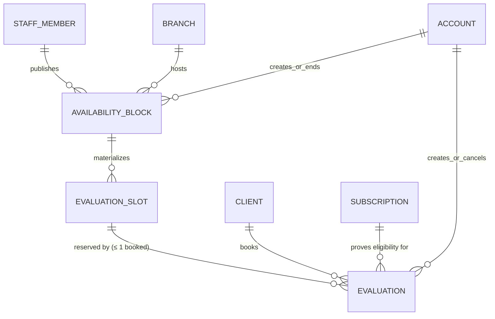

# NUT-001 — Availability Block, Evaluation slot, and Evaluation proposal

Status: **Approved 2026-09-22 under the blanket backlog-decision approval** —
the user approved PAY-002's recommended options and delegated the remaining
backlog decisions to the lead engineer on 2026-09-22. Every decision below that
is marked "Decision (taken under the 2026-09-22 blanket approval)" is part of
that approval. The approved schema, lifecycle, constraints, jobs, authorization
matrix, and API direction may be used to prepare NUT-002's exact Prisma and
generated-SQL migration review. This approval does not itself create, modify,
or apply a migration, and it does not authorize editing a design prompt or any
generated `design/` artifact.

This is the implementation-ready design for NUT-001. It follows the accepted
[Booking & Membership language](../../booking/CONTEXT.md), especially
Evaluation, Availability Block, Branch, Staff Member, Subscription, and Client;
[ADR-0059](../adr/0059-materialize-recurring-schedules.md) for recurring
materialization; [ADR-0057](../adr/0057-use-bolivia-time-for-all-business-scheduling.md)
for Bolivia time; [ADR-0024](../adr/0024-use-pg-boss-for-durable-background-jobs.md)
and [ADR-0058](../adr/0058-reconcile-due-work-into-pg-boss.md) for durable
reminders; and the accepted authorization, audit, idempotency, transaction, and
notification decisions. It mirrors the approved `session_schedules` →
`sessions` shape from [BKM-001](./BKM-001-booking-membership-schema-proposal.md)
and refines the three "Proposed" rows in the
[full release schema proposal](./full-release-schema-proposal.md).

## Scope

NUT-002 adds three Booking-owned tables and no System table:

1. `availability_blocks` — a Nutritionist's recurring weekly open range at one
   Branch, with an inclusive-start/exclusive-end effective date range;
2. `evaluation_slots` — concrete, fixed-length, individually bookable
   occurrences materialized from a block up to 30 days ahead; and
3. `evaluations` — one Client's reservation of one slot, with its monthly
   eligibility key, cancellation provenance, and reminder markers.

No `evaluation_events`, attendance, notes, measurements, room, reminder, job,
or idempotency table is proposed:

- `system.idempotency_records` protects retried Book Evaluation and block
  create/replace commands under ADR-0060;
- `system.notifications`, `system.notification_deliveries`,
  `system.audit_records`, and pg-boss remain System infrastructure reached
  through transaction-aware public ports, exactly as in PAY-001 and BOOK-001;
- an Evaluation records the appointment, not its content (design invariant 30
  §10), so there is no outcome, attendance, or detail record; and
- `sessions.branch_id` exclusion stays the only single-room protection (see
  [Evaluations and the studio room](#evaluations-and-the-studio-room)).

## Ownership and vocabulary

All three tables belong to **Booking & Membership** in the `booking`
PostgreSQL schema. Booking code calls System Identity only through its public
notification, audit, and idempotency ports; it never imports a System
repository.

- An **Availability Block** is the Nutritionist's weekly definition: one Bolivia
  weekday, a wall-clock start and end, one Branch, and an effective date range.
  It is never rewritten after it takes effect; an edit closes it and creates a
  replacement from a selected date.
- An **Evaluation slot** is a durable occurrence with exact UTC instants. It is
  `published` (visible when unbooked and still open for booking) or `withdrawn`
  (removed by a block change). A slot is never deleted and never moves in time.
- An **Evaluation** is a Client's reservation of one slot. It is `booked` or
  `cancelled`. A booked Evaluation whose slot has ended is presented as past
  ("Realizada"); that label is derived from time, not stored.
- The **eligibility month** is the first day of the Bolivia calendar month that
  contains the slot's start. It is the key of the one-per-month rule.

## Decisions

Every row below is a **Decision (taken under the 2026-09-22 blanket
approval)**. Later sections refer to them as D1–D18.

| # | Decision (taken under the 2026-09-22 blanket approval) | Rationale |
| --- | --- | --- |
| D1 | Slot length is **45 minutes, one global value**, not a per-block setting. Blocks carry no length column; slots store exact `starts_at`/`ends_at`, and a check pins `ends_at = starts_at + 45 min`. | Every generated screen (13, 14, 15, S15, S16, S17) already shows 45-minute slots; a per-block length has no screen and would let two blocks of one Nutritionist disagree. A future change is a product decision plus a migration, and stored instants keep history exact. |
| D2 | Block start and end times sit on a **15-minute grid**; a block must be at least 45 minutes long. Slots are cut back-to-back from the start; a remainder shorter than 45 minutes is unused. | Matches the designs (Mon 9:00–13:00 → 5 slots, Sat 9:00–12:00 → 4 slots; starts such as 10:30 and 11:15) and keeps pickers simple. |
| D3 | Every block is **scoped to one Branch** where the Nutritionist is currently assigned. | Glossary and booking ADR-0001 scope Evaluations/Availability Blocks to a Branch; Client 14 shows the Branch. |
| D4 | One Nutritionist **cannot have overlapping blocks or published slots, even at different Branches**, enforced by exclusion constraints. | Same reasoning as the Trainer overlap rule for Sessions: one person cannot be in two places. |
| D5 | Evaluations **do not occupy the Branch's single studio room**; no exclusion is added between slots and Sessions, and two Nutritionists may hold overlapping slots at one Branch. | The single-room rule defines a Branch's *class* schedule ("two Sessions at the same Branch never overlap"); a one-on-one consultation does not use the Pilates room or its equipment, and booking ADR-0003 deliberately models no Room. Coupling slot materialization to Session Schedules would make an Administrator's class edit silently remove Nutritionist availability. If a Branch's consultations must share the studio room, that is a Room decision under booking ADR-0003, not a hidden constraint here. |
| D6 | An edit or end takes effect from a **selected date on or after the current Bolivia date** (default: today). It withdraws only unbooked slots on or after that date whose start is still in the future; past slots and booked Evaluations remain unchanged. | ADR-0059 and the glossary. Allowing today lets the Nutritionist react to a same-day absence without waiting a day; slots that already started are never rewritten. |
| D7 | Materialization horizon is **Bolivia dates from today through today + 30**. The block command materializes synchronously; an hourly reconciler extends the horizon and repairs gaps. | ADR-0059's 30 days; synchronous materialization makes S16's counts and the Client list correct immediately after Guardar. |
| D8 | The monthly rule is **one `booked` Evaluation per Client per eligibility month** (the Bolivia month of the slot start), enforced by a partial unique index. A Client may therefore hold one in the current month and one in the next month when the 30-day horizon reaches it. | The glossary says "one per calendar month"; the month of the appointment, not the booking instant, is the only reading under which "unused months don't carry over" is unambiguous at a month boundary. Keying on booking time would let an August 31 booking consume August for a September appointment. |
| D9 | **A cancelled Evaluation frees its month.** Any cancellation (Client or staff) releases both the slot and the month. | A cancelled Evaluation was never used; the glossary's "unused months not carrying over" concerns months, not cancelled reservations. The Client can only cancel outside the 3-hour window, so the rule cannot be gamed into repeated same-day holds. Follow-up 23 left this sentence out pending this decision. |
| D10 | Booking requires an **effective active Subscription whose inclusive date range covers the slot's Bolivia date**, using the same eligibility function as Create Booking (dates, remaining allowance, future booked Sessions). The Subscription is recorded as evidence and **nothing is consumed**. A later Subscription expiry does not cancel a booked Evaluation. | Glossary: free, no allowance, not bookable without an active Subscription. Eligibility is a booking-time gate, like a Booking's Subscription at creation. |
| D11 | Booking **closes 3 hours before start**, at the same boundary as free cancellation (bookable only while `starts_at − now > 3 h`). | Every Evaluation a Client makes can be cancelled at least once, the Nutritionist always gets at least 3 hours' notice, and the 1-hour reminder is always meaningful. Sessions stay bookable until start because they have Reschedule as a fallback; Evaluations do not. |
| D12 | **No Waitlist, no Reschedule, no Attendance, no no-show.** States are only `booked` and `cancelled`; "Realizada", "Primera evaluación", and "Seguimiento" are derived read projections. | Glossary (no Waitlist, no Reschedule fallback), AW25 ("no status column"), invariant 30 §10. S15's kind label is derived: `first` when the Client has no earlier booked Evaluation, otherwise `follow_up`. |
| D13 | **Client** books and cancels only their own Evaluations. **Assistants do not book or cancel Evaluations in v1.** | The glossary lists the Assistant's on-behalf actions as Bookings, cash Payments, and account creation; no Staff screen exists for Evaluations. `created_by_account_id` and `cancelled_by_account_id` already record any Account, so adding Assistant authority later needs no migration. |
| D14 | The **Nutritionist may cancel their own booked Evaluation at any time before its start**, including inside the 3-hour window, with a mandatory Client notification and audit record. An **Administrator** may use the same command for any Evaluation. Cause: `staff_cancelled`. | The glossary keeps booked Evaluations "unless explicitly cancelled", and illness or a late emergency needs a studio-side path. The 3-hour window restrains the Client, not the studio. S15 needs a follow-up to expose the action; AW25 stays read-only in v1. |
| D15 | Removing a Nutritionist's Branch assignment, changing their Role, or archiving a Branch must **end the affected blocks** from the current Bolivia date in the same transaction. Withdrawal therefore only ever happens through a block end/replace. | One withdrawal path keeps materialization simple and avoids republishing withdrawn rows. Booked Evaluations remain and are cancelled explicitly if needed. |
| D16 | **No per-slot exception command in v1.** A one-day absence is handled by ending the block from that date and creating an identical replacement from the following day, which withdraws that day's unbooked slots and keeps booked ones. | ADR-0059 permits exceptions but no screen asks for one; the two-step edit reaches the same result through the approved path. |
| D17 | **No cross-check between Evaluations and Session Bookings.** A Client may hold an Evaluation that overlaps one of their Sessions. | Different rooms (D5), one Evaluation per month, and the Client can cancel either; adding the check would also require changing BOOK-002/003 Create Booking, Reschedule, and Waitlist promotion without a product requirement. |
| D18 | Reminders are created only for `booked` Evaluations: **day** at `starts_at − 24 h` only when the Evaluation was created before that instant and only while `now < starts_at − 1 h`; **hour** at `starts_at − 1 h` while `now < starts_at`. Cancellation makes pending reminders no-ops. | Glossary's two reminders; a booking made inside the day window does not receive a stale "tomorrow" message, and an overdue day reminder is superseded by the hour reminder. D11 guarantees the hour reminder always applies. |

## Relationship diagram



`evaluation_slots` copies the block's Nutritionist and Branch, as `sessions`
copies its schedule's Branch and Trainer, so exclusion constraints and agenda
reads need no join. A composite foreign key keeps the copies equal to the
source block.

## Proposed enums

```prisma
enum EvaluationSlotState {
  PUBLISHED @map("published")
  WITHDRAWN @map("withdrawn")

  @@schema("booking")
}

enum EvaluationState {
  BOOKED    @map("booked")
  CANCELLED @map("cancelled")

  @@schema("booking")
}

enum EvaluationCancellationCause {
  CLIENT_REQUEST  @map("client_request")
  STAFF_CANCELLED @map("staff_cancelled")

  @@schema("booking")
}
```

Blocks need no state enum: a block is current, scheduled, or ended purely from
its effective range and the Bolivia date.

## Proposed tables

Names follow the existing conventions: UUID primary keys, `camelCase` Prisma
fields mapped to `snake_case` columns, `timestamptz(3)` instants, `date` for
Bolivia civil dates, `time(0)` for Bolivia wall-clock times, restrictive
foreign keys, and constraint/index names in Prisma's default style. The SQL
below is the reviewable intent; NUT-002 produces the exact Prisma models and
generated SQL for a separate review package, as BOOK-001 and PAY-002 did.

### `availability_blocks`

| Field | Type / constraint | Purpose |
| --- | --- | --- |
| `id` | UUID primary key | Stable source identity for materialized slots. |
| `nutritionist_staff_member_id` | required FK → `booking.staff_members` | Publishing Nutritionist. Role and Branch assignment are verified by the use case. |
| `branch_id` | required FK → `booking.branches` | Branch that hosts the Evaluations. |
| `weekday` | `smallint`, ISO 1–7 | Bolivia weekday; Monday is 1 and Sunday is 7, as in `session_schedules`. |
| `starts_at_local`, `ends_at_local` | `time(0)` | Bolivia wall-clock range on the 15-minute grid, at least 45 minutes long. |
| `effective_from` | `date` | First Bolivia date this definition can generate slots. |
| `effective_until` | nullable `date`, `>= effective_from` | Exclusive end. Null means open-ended. Equal to `effective_from` records a block ended before it ever took effect (an empty range). |
| `created_by_account_id` | required FK → `system.accounts` | Nutritionist Account that published it. |
| `ended_by_account_id`, `ended_at` | nullable FK / instant | Actor and time of the end or replacement that set `effective_until`. |
| `created_at`, `updated_at` | `timestamptz(3)` | Operational timestamps. |

```sql
CREATE TABLE booking.availability_blocks (
  id                            uuid        PRIMARY KEY,
  nutritionist_staff_member_id  uuid        NOT NULL REFERENCES booking.staff_members (id) ON DELETE RESTRICT,
  branch_id                     uuid        NOT NULL REFERENCES booking.branches (id) ON DELETE RESTRICT,
  weekday                       smallint    NOT NULL,
  starts_at_local               time(0)     NOT NULL,
  ends_at_local                 time(0)     NOT NULL,
  effective_from                date        NOT NULL,
  effective_until               date,
  created_by_account_id         uuid        NOT NULL REFERENCES system.accounts (id) ON DELETE RESTRICT,
  ended_by_account_id           uuid        REFERENCES system.accounts (id) ON DELETE RESTRICT,
  ended_at                      timestamptz(3),
  created_at                    timestamptz(3) NOT NULL DEFAULT now(),
  updated_at                    timestamptz(3) NOT NULL
);

ALTER TABLE booking.availability_blocks
  ADD CONSTRAINT availability_blocks_values_check CHECK (
    weekday BETWEEN 1 AND 7
    AND ends_at_local > starts_at_local
    AND ends_at_local - starts_at_local >= interval '45 minutes'
    AND extract(second FROM starts_at_local) = 0
    AND extract(second FROM ends_at_local) = 0
    AND extract(minute FROM starts_at_local)::int % 15 = 0
    AND extract(minute FROM ends_at_local)::int % 15 = 0
    AND (effective_until IS NULL OR effective_until >= effective_from)
  ),
  -- Explicit IS NOT NULL: PostgreSQL CHECK accepts unknown/null.
  ADD CONSTRAINT availability_blocks_end_check CHECK (
    (effective_until IS NULL AND ended_at IS NULL AND ended_by_account_id IS NULL)
    OR (effective_until IS NOT NULL AND ended_at IS NOT NULL
        AND ended_by_account_id IS NOT NULL AND ended_at >= created_at)
  ),
  -- One Nutritionist never publishes overlapping weekly ranges, at any Branch.
  -- An empty effective range (until = from) overlaps nothing.
  ADD CONSTRAINT availability_blocks_nutritionist_no_overlap EXCLUDE USING gist (
    nutritionist_staff_member_id WITH =,
    weekday WITH =,
    daterange(effective_from, effective_until, '[)') WITH &&,
    tsrange(date '2000-01-03' + starts_at_local,
            date '2000-01-03' + ends_at_local, '[)') WITH &&
  );

CREATE UNIQUE INDEX availability_blocks_id_nutritionist_staff_member_id_branch_id_key
  ON booking.availability_blocks (id, nutritionist_staff_member_id, branch_id);
CREATE INDEX availability_blocks_nutritionist_staff_member_id_weekday_starts_at_local_idx
  ON booking.availability_blocks (nutritionist_staff_member_id, weekday, starts_at_local);
CREATE INDEX availability_blocks_effective_until_idx
  ON booking.availability_blocks (effective_until);
CREATE INDEX availability_blocks_branch_id_idx ON booking.availability_blocks (branch_id);
CREATE INDEX availability_blocks_created_by_account_id_idx ON booking.availability_blocks (created_by_account_id);
CREATE INDEX availability_blocks_ended_by_account_id_idx ON booking.availability_blocks (ended_by_account_id);
```

The exclusion uses the existing `btree_gist` extension (installed by
`20260908000000_booking_catalog`) for UUID and `smallint` equality. The fixed
anchor date only turns two `time` values into a comparable range; it has no
business meaning. `date + time` and `daterange` are immutable, so the
expressions are valid in an exclusion constraint.

A block row is never deleted. Its weekday, times, Branch, Nutritionist, and
`effective_from` are immutable after insert; a focused trigger rejects changes
to them and permits only the one transition that sets `effective_until`,
`ended_at`, and `ended_by_account_id`, plus `updated_at`. That makes the row a
faithful record of what was published and when it stopped.

### `evaluation_slots`

| Field | Type / constraint | Purpose |
| --- | --- | --- |
| `id` | UUID primary key | Stable occurrence identity for Evaluations and reminders. |
| `availability_block_id` | required FK → `booking.availability_blocks` | Source definition. v1 has no manual one-off slot (D16). |
| `nutritionist_staff_member_id`, `branch_id` | required; composite FK with the block | Copied from the block for exclusion and agenda reads. |
| `starts_at`, `ends_at` | `timestamptz(3)`; `ends_at − starts_at = 45 min` | Exact instants converted from the Bolivia wall clock. |
| `local_month` | `date`, first of month | Bolivia month of `starts_at`; the eligibility key copied to Evaluations. |
| `state` | `EvaluationSlotState`, default `published` | Published or withdrawn by a block end/replace. |
| `withdrawn_at` | nullable instant | Required exactly when withdrawn. |
| `created_at`, `updated_at` | `timestamptz(3)` | Operational timestamps. |

```sql
CREATE TABLE booking.evaluation_slots (
  id                            uuid        PRIMARY KEY,
  availability_block_id         uuid        NOT NULL,
  nutritionist_staff_member_id  uuid        NOT NULL,
  branch_id                     uuid        NOT NULL REFERENCES booking.branches (id) ON DELETE RESTRICT,
  starts_at                     timestamptz(3) NOT NULL,
  ends_at                       timestamptz(3) NOT NULL,
  local_month                   date        NOT NULL,
  state                         booking."EvaluationSlotState" NOT NULL DEFAULT 'published',
  withdrawn_at                  timestamptz(3),
  created_at                    timestamptz(3) NOT NULL DEFAULT now(),
  updated_at                    timestamptz(3) NOT NULL,
  CONSTRAINT evaluation_slots_block_fkey
    FOREIGN KEY (availability_block_id, nutritionist_staff_member_id, branch_id)
    REFERENCES booking.availability_blocks (id, nutritionist_staff_member_id, branch_id)
    ON DELETE RESTRICT,
  CONSTRAINT evaluation_slots_nutritionist_fkey
    FOREIGN KEY (nutritionist_staff_member_id)
    REFERENCES booking.staff_members (id) ON DELETE RESTRICT
);

ALTER TABLE booking.evaluation_slots
  ADD CONSTRAINT evaluation_slots_values_check CHECK (
    -- timestamptz − timestamptz is immutable; timestamptz + interval is only stable.
    ends_at - starts_at = interval '45 minutes'
    -- timezone(text, timestamptz) and date_trunc(text, timestamp) are immutable.
    AND local_month = date_trunc('month', starts_at AT TIME ZONE 'America/La_Paz')::date
  ),
  ADD CONSTRAINT evaluation_slots_state_check CHECK (
    (state = 'published' AND withdrawn_at IS NULL)
    OR (state = 'withdrawn' AND withdrawn_at IS NOT NULL AND withdrawn_at >= created_at)
  ),
  -- One Nutritionist never has two published slots at the same time, at any Branch.
  ADD CONSTRAINT evaluation_slots_nutritionist_no_overlap EXCLUDE USING gist (
    nutritionist_staff_member_id WITH =,
    tstzrange(starts_at, ends_at, '[)') WITH &&
  ) WHERE (state = 'published');

-- Idempotent materialization: one occurrence per source and start instant.
CREATE UNIQUE INDEX evaluation_slots_availability_block_id_starts_at_key
  ON booking.evaluation_slots (availability_block_id, starts_at);
-- Target for the Evaluation month-consistency composite FK.
CREATE UNIQUE INDEX evaluation_slots_id_local_month_key
  ON booking.evaluation_slots (id, local_month);
CREATE INDEX evaluation_slots_published_starts_at_idx
  ON booking.evaluation_slots (starts_at, id) WHERE state = 'published';
CREATE INDEX evaluation_slots_nutritionist_staff_member_id_starts_at_idx
  ON booking.evaluation_slots (nutritionist_staff_member_id, starts_at);
CREATE INDEX evaluation_slots_branch_id_starts_at_idx
  ON booking.evaluation_slots (branch_id, starts_at);
```

Unique source/start is the ADR-0059 duplicate guard. Because Bolivia has no
daylight-saving transition, one local start maps to exactly one instant, so
`starts_at` is equivalent to the local start; the conversion still goes through
the `America/La_Paz` tz database rather than a hard-coded offset.

After insert, `availability_block_id`, the copied Nutritionist and Branch,
`starts_at`, `ends_at`, and `local_month` are immutable (trigger-enforced); only
`published → withdrawn` is permitted, once. A withdrawn slot is kept because
cancelled Evaluations may reference it and because it documents what clients
could see.

### `evaluations`

| Field | Type / constraint | Purpose |
| --- | --- | --- |
| `id` | UUID primary key | Stable Evaluation identity. |
| `client_id` | required FK → `booking.clients` | Client attending. |
| `evaluation_slot_id` | required FK → `booking.evaluation_slots` | Reserved occurrence. |
| `eligibility_month` | `date`, composite FK with slot | Copy of the slot's `local_month`; key of the monthly rule. |
| `subscription_id` | required; composite FK `(subscription_id, client_id)` | Active Subscription that proved eligibility. Nothing is consumed. |
| `state` | `EvaluationState`, default `booked` | Booked or cancelled. |
| `created_by_account_id` | required FK → `system.accounts` | Client Account in v1 (D13). |
| `cancelled_at`, `cancelled_by_account_id`, `cancellation_cause` | nullable instant / FK / enum | Required exactly when cancelled. |
| `day_reminder_recorded_at`, `hour_reminder_recorded_at` | nullable instants | Evidence that each reminder Notification was recorded; reconciler markers. |
| `created_at`, `updated_at` | `timestamptz(3)` | Operational timestamps. |

```sql
CREATE TABLE booking.evaluations (
  id                         uuid        PRIMARY KEY,
  client_id                  uuid        NOT NULL REFERENCES booking.clients (id) ON DELETE RESTRICT,
  evaluation_slot_id         uuid        NOT NULL,
  eligibility_month          date        NOT NULL,
  subscription_id            uuid        NOT NULL,
  state                      booking."EvaluationState" NOT NULL DEFAULT 'booked',
  created_by_account_id      uuid        NOT NULL REFERENCES system.accounts (id) ON DELETE RESTRICT,
  cancelled_at               timestamptz(3),
  cancelled_by_account_id    uuid        REFERENCES system.accounts (id) ON DELETE RESTRICT,
  cancellation_cause         booking."EvaluationCancellationCause",
  day_reminder_recorded_at   timestamptz(3),
  hour_reminder_recorded_at  timestamptz(3),
  created_at                 timestamptz(3) NOT NULL DEFAULT now(),
  updated_at                 timestamptz(3) NOT NULL,
  CONSTRAINT evaluations_slot_month_fkey
    FOREIGN KEY (evaluation_slot_id, eligibility_month)
    REFERENCES booking.evaluation_slots (id, local_month) ON DELETE RESTRICT,
  CONSTRAINT evaluations_subscription_client_fkey
    FOREIGN KEY (subscription_id, client_id)
    REFERENCES booking.subscriptions (id, client_id) ON DELETE RESTRICT
);

ALTER TABLE booking.evaluations
  ADD CONSTRAINT evaluations_values_check CHECK (
    extract(day FROM eligibility_month) = 1
    AND (day_reminder_recorded_at IS NULL OR day_reminder_recorded_at >= created_at)
    AND (hour_reminder_recorded_at IS NULL OR hour_reminder_recorded_at >= created_at)
  ),
  ADD CONSTRAINT evaluations_state_check CHECK (
    (state = 'booked' AND cancelled_at IS NULL
      AND cancelled_by_account_id IS NULL AND cancellation_cause IS NULL)
    OR (state = 'cancelled' AND cancelled_at IS NOT NULL
      AND cancelled_by_account_id IS NOT NULL AND cancellation_cause IS NOT NULL
      AND cancelled_at >= created_at)
  );

-- A slot holds at most one live Evaluation; a cancelled one frees it.
CREATE UNIQUE INDEX evaluations_one_booked_per_slot_key
  ON booking.evaluations (evaluation_slot_id) WHERE state = 'booked';
-- One booked Evaluation per Client per Bolivia month (D8); cancellation frees it (D9).
CREATE UNIQUE INDEX evaluations_one_booked_per_client_month_key
  ON booking.evaluations (client_id, eligibility_month) WHERE state = 'booked';
CREATE INDEX evaluations_client_id_state_idx ON booking.evaluations (client_id, state);
CREATE INDEX evaluations_evaluation_slot_id_idx ON booking.evaluations (evaluation_slot_id);
CREATE INDEX evaluations_subscription_id_idx ON booking.evaluations (subscription_id);
CREATE INDEX evaluations_created_by_account_id_idx ON booking.evaluations (created_by_account_id);
CREATE INDEX evaluations_cancelled_by_account_id_idx ON booking.evaluations (cancelled_by_account_id);
CREATE INDEX evaluations_reminders_pending_idx
  ON booking.evaluations (evaluation_slot_id)
  WHERE state = 'booked' AND hour_reminder_recorded_at IS NULL;
```

Because a past Evaluation stays `booked`, the per-month partial unique index
covers used months as well as upcoming ones, which is exactly the rule: a
month is used by a booked Evaluation, past or future, and freed only by a
cancellation. `subscriptions (id, client_id)` already exists as a unique key
from the booking-workflow migration.

After insert, the Client, slot, month, Subscription, creator, and creation time
are immutable (trigger-enforced). The trigger permits the single
`booked → cancelled` transition and the one-time setting of each reminder
marker.

### Cross-table guards

Two invariants span tables. The owning use cases enforce them under the locks
described below, and narrow `BEFORE` triggers are the last-resort guard,
covered by real PostgreSQL tests:

- an Evaluation may be inserted as `booked` only against a `published` slot;
  and
- a slot may move to `withdrawn` only when no `booked` Evaluation references it.

The triggers inspect identifiers and states only; they make no time or
workflow decision.

## Evaluations and the studio room

Decision D5 keeps slots independent of Sessions. Concretely, NUT-002 adds no
exclusion between `evaluation_slots` and `sessions`, no Branch-level slot
exclusion, and no check against the Nutritionist appearing on a Session (the
Nutritionist Role never leads Sessions, and `sessions.trainer_staff_member_id`
is application-validated as a Trainer). The only person-level protection is
D4: one Nutritionist, one place at a time.

## Materialization

Materialization follows ADR-0059 and ADR-0058 and is the first recurring
materializer in the backend; the Session Schedule reconciler should reuse its
horizon function and job shape.

### Algorithm

For one block and the horizon `today .. today + 30` (Bolivia dates):

1. For each date `d` in `max(today, effective_from) .. min(today + 30,
   effective_until − 1)` whose ISO weekday equals `weekday`:
2. for `k = 0 .. floor((ends_at_local − starts_at_local) / 45 min) − 1`,
   compute the local start `d + starts_at_local + 45k` and convert it through
   `America/La_Paz` to `starts_at`;
3. skip any `starts_at <= now()` (past or already-started occurrences are never
   created); and
4. insert the remaining rows with `INSERT … ON CONFLICT DO NOTHING` (Prisma
   `createMany({ skipDuplicates: true })`).

`ON CONFLICT DO NOTHING` without a conflict target treats both the unique
source/start index and the published-slot exclusion constraint as arbiters.
A duplicate run is a no-op, and a new slot that would overlap a still-published
slot of the same Nutritionist (a booked slot kept from an ended block) is
skipped rather than failing the batch. Skipped overlaps are counted in the job
result for monitoring.

### Commands that change blocks

| Command | Isolation | Preconditions and atomic result |
| --- | --- | --- |
| Create block | Serializable; `Idempotency-Key` required | Actor is a Nutritionist assigned to the Branch; Branch not archived; values satisfy D1/D2; `effective_from >= today`. Insert the block and materialize its horizon in the same transaction. An overlap returns `availability-block-overlap`. |
| Replace block (edit) | Serializable; `Idempotency-Key` required | Target block belongs to the actor and is current or scheduled (`effective_until` null or `> today`). The selected date `D` satisfies `today <= D` and, when the block has an end, `D < effective_until`. Set `effective_until = max(D, effective_from)`, `ended_at`, `ended_by_account_id`; withdraw its future unbooked slots on or after `D`; insert the replacement from `max(D, effective_from)` inheriting any previous `effective_until`; materialize the replacement. An exact replay returns the same replacement. |
| End block ("Eliminar horario") | Serializable; target-addressed | Same ownership and date rules. Set the end fields and withdraw future unbooked slots on or after `D`. Booked Evaluations remain (D6). An equivalent retry against an already-ended block with the same `D` returns the existing state; a different `D` conflicts. |
| Materialize block (job) | Serializable, bounded retries | Reload the block; if it no longer covers any horizon date, succeed as a no-op. Otherwise apply the algorithm. |

Withdrawal is one conditional update per slot:
`state = 'withdrawn', withdrawn_at = now()` for published slots of that block
with `starts_at > now()`, local date `>= D`, and no booked Evaluation. Slot rows
are locked `FOR UPDATE` in `(starts_at, id)` order before the check, so a
concurrent Book Evaluation either commits first (the slot is kept) or waits and
then sees `withdrawn`.

When a booked Evaluation on a kept slot of an ended block is later cancelled,
the cancellation transaction also withdraws that slot if its local date is on
or after its block's `effective_until`. The next reconciler run then
materializes the replacement block's slot at that time, if one covers it. A
freed slot of a still-current block simply stays published and bookable, as
the glossary requires.

### Reconciler and jobs

| Job | Trigger | Key | Behavior |
| --- | --- | --- | --- |
| `evaluation-slots.reconcile` | pg-boss schedule, hourly at minute 5, plus once at worker start | pg-boss singleton per run | Find blocks whose effective range intersects the horizon and enqueue one materialize job each. |
| `evaluation-slots.materialize-block` | Enqueued by the reconciler | `evaluation-slots:{blockId}:{horizonEndDate}` | Apply the algorithm above; stale or duplicate work is a no-op. Short internal-job retry preset (ADR-0064). |

Hourly is enough because the horizon only moves at Bolivia midnight and every
block command materializes synchronously. The reconciler does not withdraw
anything; withdrawal happens only in block commands (D15).

## Evaluation commands

All commands reload current state and use the PostgreSQL clock. Bolivia
calendar rules use `America/La_Paz`. Allocation and cancellation use short
Prisma interactive transactions at `Serializable` with the existing bounded
`retry-serializable` helper under ADR-0056. Deterministic business conflicts
are not retried. Transactions record Notifications, audit rows, idempotency
records, and pg-boss work but never call a provider.

Lock order is always Client row, then slot row(s) in `(starts_at, id)` order,
then Evaluation row. Block commands lock the block, then slots in the same
order, and never lock Clients, so no lock cycle exists.

| Command | Idempotency | Preconditions and atomic result |
| --- | --- | --- |
| Book Evaluation | `Idempotency-Key` required | Actor is the Client (D13). Lock the Client row and the slot. Slot is `published`, has no booked Evaluation, and `starts_at − now > 3 h` (D11). The Client has an effective active Subscription whose `starts_on .. ends_on` contains the slot's Bolivia date (D10) and no booked Evaluation for the slot's `local_month` (D8). Insert `booked` with `eligibility_month = local_month` and the Subscription; record the Nutritionist's "new Evaluation" Notification; store the idempotent response. A unique-index violation maps to `evaluation-slot-unavailable` or `evaluation-month-used`. |
| Cancel own Evaluation | Target-addressed | Actor is the owning Client; state is `booked`; `starts_at − now > 3 h` strictly. Mark `cancelled/client_request` with actor and time; apply the kept-slot withdrawal rule; record the Nutritionist's cancellation Notification. The slot and month are freed (D9). An equivalent retry on an already-cancelled Evaluation returns it; inside the window returns `evaluation-cancellation-window-closed`. |
| Cancel Evaluation as staff | Target-addressed | Actor is the slot's Nutritionist or an Administrator (D14); state is `booked`; `now < starts_at`. Mark `cancelled/staff_cancelled`; apply the kept-slot withdrawal rule; record the Client's audible cancellation Notification; append one audit record. Equivalent retry returns the settled state. |
| Send reminder (job) | Stable job key | See [Reminders](#reminders). |

At the exact `starts_at − 3 h` boundary, both booking and Client cancellation
are closed. Both partial unique indexes remain the final protection if a code
path ever skips a lock: two concurrent bookings of one slot, or of two slots in
one month by one Client, cannot both commit.

Idempotency records for Book Evaluation and block create/replace follow the
ordinary retention policy and are kept for at least 48 hours, matching PAY-001's
lost-response replay window.

## Reminders

Reminders use the durable reconciler-plus-job pattern of ADR-0058 and the
existing Notification recorder, which deduplicates on
`(account_id, business_event_key)`.

| Job | Trigger | Key | Behavior |
| --- | --- | --- | --- |
| `evaluation-reminders.reconcile` | pg-boss schedule every 5 minutes | pg-boss singleton per run | Find booked Evaluations with a null marker whose due instant falls before `now + 10 min`, and enqueue a send job with `startAfter` = due instant. |
| `evaluation-reminders.send` | Enqueued by the reconciler | `evaluation-reminder:{evaluationId}:{day\|hour}` | Reload the Evaluation and slot. Succeed as a no-op unless it is still `booked`, the marker is null, and the D18 applicability window still holds. Otherwise, in one transaction, record the Client Notification and set the marker. Delivery is queued after commit through the existing notification delivery path. |

Rules, all from D18:

- **Day reminder** — due `starts_at − 24 h`; applies only if
  `created_at < starts_at − 24 h`; sent only while `now < starts_at − 1 h`.
- **Hour reminder** — due `starts_at − 1 h`; sent only while `now < starts_at`.
  Because booking closes 3 hours ahead (D11), every Evaluation receives it.
- **Cancelled** — both jobs become no-ops; nothing is deleted or recalled.
- **Worker outage** — the next scan rediscovers missing work. A day reminder
  that became overdue past `starts_at − 1 h` is skipped because the hour
  reminder supersedes it.

The markers make "already sent" a booking-owned fact, so the reconciler never
has to read `system.notifications` across the context boundary.

## Notifications and audit

### Notification catalog

| Event | Recipient | Category | Type | Business event key | Sound (ADR-0070) |
| --- | --- | --- | --- | --- | --- |
| Client books | Slot's Nutritionist | `booking_schedule` | `evaluation_booked` | `evaluation-booked:{evaluationId}` | Silent |
| Client cancels | Slot's Nutritionist | `booking_schedule` | `evaluation_cancelled` | `evaluation-cancelled:{evaluationId}` | Silent |
| Staff cancels | Client | `booking_schedule` | `evaluation_cancelled_by_studio` | `evaluation-cancelled:{evaluationId}` | Audible |
| Day reminder | Client | `reminder` | `evaluation_reminder_day` | `evaluation-reminder-day:{evaluationId}` | Audible |
| Hour reminder | Client | `reminder` | `evaluation_reminder_hour` | `evaluation-reminder-hour:{evaluationId}` | Audible |

Each Evaluation is cancelled at most once, so the per-Evaluation keys are
stable. A recipient without an Account receives no Notification. Destinations
are `{ type: 'evaluation', id }` for the Client and the Nutritionist agenda for
staff; there is no detail screen behind either (invariant 30 §10).

Inbox text may carry the day and time (Client 19 and S20 already show
"Recordatorio: tu evaluación nutricional es mañana." and "Nueva evaluación
agendada: mañana 09:00 con Paola Suárez."). **Push lock-screen text for every
Evaluation type must be generic** — for example "Tienes un recordatorio de tu
cita" — because ADR-0025 excludes Evaluation information from the lock screen.
The Evaluation types therefore declare a separate privacy-safe push title and
body in the notification catalog.

### Audit decisions (ADR-0055)

| Command | Audited | Reason |
| --- | --- | --- |
| Book / Client cancel | No | Routine Client activity; the Evaluation row keeps actor, time, and cause. |
| Create / replace / end block | No | The Nutritionist manages their own availability; block rows are immutable and record creator, ender, and time, so an audit row adds no information. |
| Staff cancel | Yes: `evaluation.cancelled_by_staff` | A studio-side action against a Client's appointment, possibly inside the Client's window. |
| Assignment removal/Branch archival ending blocks (D15) | Covered by that command's existing audit | Role and Branch-access changes are already in the audit catalog. |

The staff-cancel record targets the Evaluation and stores actor Account and
Role, the slot's Branch, the correlation identifier, and metadata
`{ cause: 'staff_cancelled', insideClientWindow: boolean }`. It never copies
the Client's name or any appointment content.

## Authorization matrix

Default-deny, enforced in the use case under ADR-0054. "Own" for the
Nutritionist means `evaluation_slots.nutritionist_staff_member_id` or
`availability_blocks.nutritionist_staff_member_id` equals their Staff Member.

| Action | Client | Nutritionist | Assistant | Trainer | Administrator |
| --- | --- | --- | --- | --- | --- |
| Browse bookable slots and monthly eligibility | Own eligibility | No | No | No | No |
| Book Evaluation | Self only | No | No (D13) | No | No |
| Cancel within Client rules | Own only | — | No (D13) | No | — |
| Cancel as staff, any time before start | No | Own slots only | No | No | Any (D14) |
| Read upcoming/past Evaluations | Own only | Own agenda only | No | No | All, read-only (AW25) |
| Create / replace / end Availability Block | No | Own, at an assigned Branch | No | No | No in v1 |
| Read Availability Blocks | No | Own | No | No | Read-only (future AW surface) |
| Materialize slots, send reminders | Worker authority only, never a caller-supplied Role | | | | |

Branch assignment is re-checked on every Nutritionist write because opaque
Authentication Sessions carry no claims. A Client's browse is not
Branch-scoped: Clients have no home Branch and may book at any Branch.

## API sketch for NUT-002

Explicit `/api/v1` commands and screen-shaped reads under ADR-0018/0020, RFC
9457 errors, and the existing route style (role prefixes such as `trainer/`,
`assistant/`, `administrator/`; `DELETE` for Client cancellation as with
Bookings). Mutations use `Cache-Control: no-store`; reads are private and
revalidated (ADR-0063), and the mobile apps keep Evaluation data out of the
persisted offline cache (ADR-0035). Exact DTOs are reviewed in NUT-002.

### Client (13, 14, 15)

| Method and path | Purpose |
| --- | --- |
| `GET /api/v1/evaluation-slots?from=&to=&branchId=` | Screen 13. Bookable slots only (published, unbooked, `starts_at − now > 3 h`, inside the horizon, in a month the Client has not used), grouped by Bolivia date, with Nutritionist name, Branch, and 45-minute duration. Also returns a per-month eligibility summary (`available` or `used`, with the using Evaluation's date and time) so the used-month state and "next available" line need no second call. |
| `GET /api/v1/evaluation-slots/{slotId}` | Screen 14 summary for a deep link or refresh: date, time, duration, Branch, Nutritionist, and whether it is still bookable. |
| `POST /api/v1/evaluation-slots/{slotId}/evaluations` | Book. `Idempotency-Key` required. `201` with the Evaluation. |
| `GET /api/v1/evaluations?scope=upcoming` | Screen 15 "Próxima": booked Evaluations with `ends_at > now`, each with `cancellableUntil` (`starts_at − 3 h`). |
| `GET /api/v1/evaluations?scope=past&cursor=` | Screen 15 "Anteriores": booked Evaluations with `ends_at <= now`, newest first, cursor-paginated (ADR-0061). Cancelled Evaluations are not listed, mirroring class history. |
| `DELETE /api/v1/evaluations/{evaluationId}` | Client cancellation. `204`; equivalent retry `204`. |

### Nutritionist (S15, S16, S17)

| Method and path | Purpose |
| --- | --- |
| `GET /api/v1/nutritionist/evaluations?from=&cursor=` | S15 agenda: own booked Evaluations with `ends_at > now`, ordered `starts_at, id`, with Client display name, time, duration, Branch, and derived kind (`first` / `follow_up`). |
| `DELETE /api/v1/nutritionist/evaluations/{evaluationId}` | Staff cancellation of an own Evaluation (D14). |
| `GET /api/v1/nutritionist/availability-blocks` | S16: own current and scheduled blocks ordered by weekday then start, each with Branch, `effectiveFrom`, `effectiveUntil`, slots per week, and upcoming booked Evaluation count. |
| `POST /api/v1/nutritionist/availability-blocks` | S17 create: `branchId`, `weekday`, `startsAtLocal`, `endsAtLocal`, `effectiveFrom`. `Idempotency-Key` required. |
| `POST /api/v1/nutritionist/availability-blocks/{blockId}/replacement` | S17 edit: new values plus `effectiveFrom`. `Idempotency-Key` required. Returns ended and replacement blocks plus counts of withdrawn slots and kept booked Evaluations. |
| `POST /api/v1/nutritionist/availability-blocks/{blockId}/end` | S17 "Eliminar horario": `effectiveFrom`. Returns the kept booked Evaluation count so the confirmation can say those appointments remain. |

### Administrator (later, WEB-008)

| Method and path | Purpose |
| --- | --- |
| `GET /api/v1/administrator/evaluations?from=&to=&nutritionistId=&page=` | AW25 read-only oversight list with offset pagination and allowlisted filters (ADR-0062). |
| `DELETE /api/v1/administrator/evaluations/{evaluationId}` | Staff cancellation for any Evaluation (D14). Implemented in NUT-002's use case; exposed when an admin surface asks for it. |

### Stable error codes

At minimum: `evaluation-slot-unavailable` (withdrawn, taken, or started),
`evaluation-booking-closed` (inside 3 h), `evaluation-month-used`,
`subscription-not-active` (reusing the Booking code when it already exists),
`evaluation-not-booked`, `evaluation-cancellation-window-closed`,
`availability-block-overlap`, `availability-block-invalid-range`,
`availability-block-effective-date-past`, `availability-block-ended`,
`branch-not-assigned`, and `idempotency-key-reused`. Exact transport names
receive contract review in NUT-002.

## Representative rows

Readable identifiers stand in for UUIDs.

| Event | Resulting rows |
| --- | --- |
| Carla publishes Mondays 9:00–13:00 at Centro from 2026-09-21 | `availability_blocks(id=carlaMonCentro, nutritionist=carla, branch=centro, weekday=1, 09:00–13:00, effective_from=2026-09-21, effective_until=null)`; materialization creates five slots per Monday (09:00, 09:45, 10:30, 11:15, 12:00 local, i.e. 13:00Z…16:00Z) through 2026-10-22. |
| Ana books Monday 2026-09-28 09:45 | `evaluations(id=evalAna, client=ana, slot=mon28_0945, eligibility_month=2026-09-01, subscription=anaPack8, state=booked, created_by=anaAccount)`; `anaPack8.remaining_class_allowance` unchanged; Carla gets `evaluation-booked:evalAna`. |
| Ana tries a second September slot | Rejected `evaluation-month-used` by `evaluations_one_booked_per_client_month_key`. An October 5 slot is accepted. |
| A slot on 2026-09-30 at 23:15 Bolivia | Stored `starts_at=2026-10-01T03:15Z`, `local_month=2026-09-01`: it counts for September. |
| Carla edits to 10:00–13:00 from 2026-10-05 | `carlaMonCentro.effective_until=2026-10-05`, ended fields set; its unbooked slots from Oct 5 are `withdrawn`; Ana's booked Oct 5 09:45 slot stays `published`; new block `carlaMonCentro2` from Oct 5 materializes 10:00, 10:45, 11:30, and 12:15 — its Oct 5 10:00 slot is skipped because it overlaps Ana's kept 09:45–10:30 slot. |
| Ana cancels Oct 5 more than 3 h ahead | `evalAna2.state=cancelled/client_request`; the kept slot is withdrawn because Oct 5 is on or after its block's end; October is free again; the next reconcile publishes `carlaMonCentro2`'s 10:00 slot. |
| Carla cancels Lucía's Evaluation 1 h before | `state=cancelled/staff_cancelled`, actor Carla; Lucía's month is free; audible `evaluation_cancelled_by_studio` for Lucía; one `evaluation.cancelled_by_staff` audit row with `insideClientWindow=true`. |
| Paola books at 20:00 for tomorrow 09:00 | No day reminder (booked inside 24 h); hour reminder at 08:00 sets `hour_reminder_recorded_at`. |

## Migration and rollout order

1. **Review package** — NUT-002 first writes
   `docs/implementation/prisma/nutritionist-evaluations.prisma`,
   `docs/implementation/sql/nutritionist-evaluations-constraints.sql`, and a
   rejection-case review test, as BOOK-001 did.
2. **One additive migration**, for example
   `2026MMDD000000_nutritionist_evaluations`: three enums, three tables,
   checks, exclusion constraints, partial unique indexes, immutability and
   cross-table guard triggers, and the new relations on `StaffMember`,
   `Branch`, `Client`, `Subscription`, `Account`. No drops, no backfill, no
   seed. Production follows the staged migration process of ADR-0078.
3. **Booking repository and commands** — block create/replace/end with
   synchronous materialization, Book, Client cancel, staff cancel, and the
   shared horizon function.
4. **Worker** — the two reconcilers, two job families with typed retry/timeout
   presets (ADR-0064), and failed-job retention (ADR-0065).
5. **Notification catalog** — five types, sound flags, and privacy-safe push
   text.
6. **HTTP and OpenAPI** — endpoints above, regenerated `api-contracts`
   (ADR-0050).
7. **Development fixtures** — one Nutritionist with blocks at the fixture
   Branches so MOB-016 can run locally.
8. **D15 hooks** — staff assignment removal, Role change, and Branch archival
   end affected blocks; implemented where those commands live (WEB-003 or the
   staff-management slice), with a NUT-002 port they call.
9. **Design follow-ups** below are sent before MOB-016 builds the affected
   frames.

## Test plan

All database tests run against real PostgreSQL 17 through the existing
Testcontainers helper or a dedicated `pilates_test_*` database (ADR-0049). No
normal development or production database is targeted.

**Constraint rejection cases** (review SQL test, like BKM-001's 40 cases):
weekday out of range; end before start; range shorter than 45 minutes; times
off the 15-minute grid or with seconds; `effective_until < effective_from`;
end fields partially set; overlapping blocks for one Nutritionist on the same
weekday at the same or a different Branch; empty-range block overlapping
nothing; slot length other than 45 minutes; `local_month` not matching the
Bolivia month (including 23:15 on the last day of a month); withdrawn without
timestamp; overlapping published slots across Branches; withdrawn slots not
conflicting; duplicate source/start; Evaluation month differing from the slot;
Subscription of another Client; `booked` with cancellation fields; `cancelled`
missing actor or cause; second booked Evaluation per slot; second booked
Evaluation per Client/month; immutability trigger rejections; booking a
withdrawn slot; withdrawing a booked slot.

**Concurrency** (overlapping real transactions, verifying the losing error and
surviving row count): two Clients booking one slot; one Client booking two
slots in the same month; Book versus block end/replace withdrawing that slot;
Book versus staff cancel of the previous holder; Client cancel versus staff
cancel; two materialization jobs for one block; materialization versus block
replacement; idempotent Book first execution, exact replay, conflicting reuse,
and concurrent same-key submission; same for block create/replace.

**Time boundaries with a controlled clock**: booking and Client cancel at
exactly `starts_at − 3 h` (closed), one millisecond earlier (open); staff cancel
until start; month assignment around Bolivia midnight on the last day of a
month; horizon edges at today and today + 30; `effective_from = today` with
past slots skipped; replace with `D` before `effective_from`.

**Reminders**: day and hour sent once under duplicate jobs; day skipped when
booked inside 24 h; overdue day skipped after `starts_at − 1 h`; both no-ops
after cancellation; recorded Notification plus marker in one transaction;
Nutritionist and Client recipients without an Account.

**Use-case and contract tests**: every row of the authorization matrix allowed
and denied, including a Nutritionist on another Nutritionist's block, an
unassigned Branch, and an Assistant attempt; eligibility with no, expired,
zero-allowance-with-future-Session, and date-range-excluding Subscriptions;
derived kind and "past" projections; kept-slot withdrawal on cancel; RFC 9457
codes; pagination order; current/previous mobile compatibility (ADR-0016).

## Required design follow-ups

The schema and API follow the glossary and the decisions above where the
generated screens are silent or have drifted. Before MOB-016 implements the
affected frames, focused follow-ups under the design workflow should:

1. **S17** — add an "A partir del" date field (default today, no earlier date),
   and a Branch picker shown only when the Nutritionist has more than one
   assigned Branch; the edit/end confirmation says booked Evaluations remain
   ("Las N evaluaciones ya reservadas se mantienen").
2. **S16** — show "desde" / "hasta" dates on blocks that start or end in the
   future, and the Branch on each card when there is more than one.
3. **Client 13** — the picker omits days in a month already used, so the
   used-month frame appears only when no unused month has open slots in the
   horizon; its "next available" line names the next unused month; show the
   Branch (and Nutritionist when there is more than one) per slot; slots
   disappear 3 hours before start.
4. **Client 15** — up to two upcoming cards can exist across a month boundary
   (drop "como máximo una"); the cancel sheet states that the month's
   Evaluation becomes available again; inside 3 hours the card shows that it
   can no longer be cancelled instead of **Cancelar**; "Realizada" is a
   time-derived label.
5. **S15** — add a cancel action on the selected card with an S14-style
   confirmation that the Client will be notified; S15's "Primera evaluación" /
   "Seguimiento" label is derived as defined in D12.
6. **Client 19 / S20** — add the studio-cancelled Evaluation notice for the
   Client and the Client-cancelled notice for the Nutritionist.

These are follow-ups for the design session, never edits to `design/` or to
an already-sent prompt.

## Deliberately excluded

- Assistant or Administrator booking on a Client's behalf (D13).
- Per-slot exceptions, manual one-off slots, and per-block slot lengths (D1,
  D16).
- Waitlist, Reschedule, Attendance, no-show, notes, or measurements (D12).
- Any link between Evaluation slots and Sessions or the studio room (D5, D17).
- Administrator block editing and an admin cancel surface in v1.

## Open questions

Only externally gated items remain; every product and engineering choice above
is decided.

1. **Evaluation data retention and Account closure** — gated by BE-007 (data
   governance, a production gate). This proposal keeps all Evaluation rows
   indefinitely with restrictive foreign keys until BE-007 sets the policy.
2. **Design export** — the six follow-ups above depend on the external design
   session applying them; MOB-016 builds from the accepted behavior if the
   export lags, as MOB-004 did for authentication.
3. **Push provider text limits** — the generic Evaluation lock-screen copy is
   verified against Expo/APNs/FCM rendering when push delivery for these types
   is integrated; the inbox text is unaffected.

## Governing sources

- [Booking & Membership context](../../booking/CONTEXT.md) and booking ADRs
  [0001](../../booking/docs/adr/0001-model-branch-as-first-class-entity.md) and
  [0003](../../booking/docs/adr/0003-model-the-studio-as-branch-only.md)
- [ADR-0059](../adr/0059-materialize-recurring-schedules.md),
  [ADR-0057](../adr/0057-use-bolivia-time-for-all-business-scheduling.md),
  [ADR-0058](../adr/0058-reconcile-due-work-into-pg-boss.md),
  [ADR-0024](../adr/0024-use-pg-boss-for-durable-background-jobs.md),
  [ADR-0064](../adr/0064-use-bounded-retry-policies-by-job-family.md)
- [ADR-0054](../adr/0054-enforce-contextual-authorization-in-use-cases.md),
  [ADR-0055](../adr/0055-store-focused-audit-records-in-postgresql.md),
  [ADR-0056](../adr/0056-use-serializable-transactions-selectively.md),
  [ADR-0060](../adr/0060-require-idempotency-keys-for-retry-sensitive-commands.md),
  [ADR-0009](../adr/0009-separate-system-account-from-domain-identities.md)
- [ADR-0025](../adr/0025-use-expo-push-service-for-mobile-notifications.md),
  [ADR-0068](../adr/0068-enable-all-initial-notification-categories.md),
  [ADR-0070](../adr/0070-use-sound-only-for-actionable-notifications.md),
  [ADR-0035](../adr/0035-use-an-online-first-read-only-mobile-cache.md)
- [BKM-001](./BKM-001-booking-membership-schema-proposal.md),
  [BOOK-001](./BOOK-001-booking-workflow-schema-proposal.md),
  [PAY-001](./PAY-001-payment-schema-proposal.md), and the
  [full release schema proposal](./full-release-schema-proposal.md)
- Affected prompts: Client
  [13](../design/prompts/client/13-evaluation-availability.md),
  [14](../design/prompts/client/14-book-evaluation.md),
  [15](../design/prompts/client/15-my-evaluations.md); Staff
  [S15](../design/prompts/staff/15-nutritionist-agenda.md),
  [S16](../design/prompts/staff/16-nutritionist-availability.md),
  [S17](../design/prompts/staff/17-nutritionist-availability-form.md); admin
  [AW25](../design/prompts/admin-web/25-evaluaciones-nutricionales.md); and
  follow-ups [23](../design/prompts/followups/23-client-cancel-confirmation.md),
  [24](../design/prompts/followups/24-booking-confirmed-notice.md),
  [26](../design/prompts/followups/26-nutritionist-agenda-caption.md), and
  [30](../design/prompts/followups/30-invariants-checklist.md)
