# Full release schema proposal

Status: partially approved. The lean System foundation, image upload intent,
Client/Staff/Branch foundation, and six-table Booking catalog are approved.
The catalog implementation is recorded in the
[BKM-002 handoff](./BKM-002-persistence-handoff.md). Remaining release tables
stay proposed until reviewed. Concrete insert scenarios and representative rows
for the implemented foundation are in
[`approved-foundation-table-examples.md`](./approved-foundation-table-examples.md).

## Scope and sources

This proposal covers the application tables needed for the documented first
release. It was checked against:

- the System Identity, Booking & Membership, and Back Office glossaries;
- the accepted architecture decisions, including authentication,
  authorization, auditing, time, idempotency, notifications, uploads, money,
  recurring materialization, and transaction boundaries;
- all 80 generated product screens: 23 Client, 23 Staff, and 34 admin-web
  screens, plus the generated design-system reference;
- the source prompts and applied/pending design follow-ups; and
- the implementation backlog through the initial mobile, backend, and admin
  release.

Generated files under `design/` were audited read-only and were not changed.
Pending authentication follow-ups 33–38 override the generated screens' stale
phone-login and temporary-password examples: email is the only login
identifier, and staff-created Accounts use Activation Links.

## Proposed ownership

- `system` owns Accounts, authentication security, audit,
  idempotency, notifications, devices, and uploaded-image metadata.
- `booking` owns Clients, Staff Members, Branches, catalog, schedules,
  Bookings, Evaluations, Payments, Credits, Referrals, and Promotions.
- `back_office` owns Supplies, Withdrawals, Salary Payments, Expense
  Categories, and Expenses.
- The separately reviewed pg-boss technical schema owns queue internals. Its
  vendor tables are not Prisma domain models and are not duplicated here.

## Complete relationship diagram

```mermaid
flowchart TB
  subgraph SYSTEM[system schema]
    Account[accounts]
    AuthToken[authentication_tokens]
    AuthSession[authentication_sessions]
    ThrottleEvent[authentication_throttle_events]
    EmailSuppression[email_suppressions]
    Audit[audit_records]
    Idempotency[idempotency_records]
    Notification[notifications]
    Device[account_devices]
    Delivery[notification_deliveries]
    Image[image_assets]
    Variant["image_variants (proposed)"]

    Account --> AuthToken
    Account --> AuthSession
    Account --> Notification
    Account --> Device
    Notification --> Delivery
    Device --> Delivery
    Image --> Variant
  end

  subgraph BOOKING[booking schema]
    Client[clients]
    Staff[staff_members]
    Branch[branches]
    StaffBranch[staff_branch_assignments]
    Plan[plans]
    ClassType[class_types]
    SessionSchedule[session_schedules]
    Session[sessions]
    Subscription[subscriptions]
    Booking[bookings]
    Waitlist[waitlist_entries]
    Attendance[attendance_records]
    Availability[availability_blocks]
    EvaluationSlot[evaluation_slots]
    Evaluation[evaluations]
    Payment[payments]
    CreditAccount[credit_accounts]
    CreditEntry[credit_entries]
    Referral[referrals]
    Promotion[promotions]

    Staff --> StaffBranch --> Branch
    ClassType --> SessionSchedule
    Staff --> SessionSchedule
    Branch --> SessionSchedule --> Session
    Plan --> Subscription
    Client --> Subscription
    Client --> Booking
    Subscription --> Booking
    Session --> Booking --> Attendance
    Client --> Waitlist
    Session --> Waitlist
    Staff --> Availability
    Branch --> Availability --> EvaluationSlot --> Evaluation
    Client --> Evaluation
    Client --> Payment
    Plan --> Payment
    Client --> CreditAccount --> CreditEntry
    Client --> Referral
    Payment --> CreditEntry
    Referral --> CreditEntry
  end

  subgraph BACKOFFICE[back_office schema]
    Supply[supplies]
    Withdrawal[withdrawals]
    Salary[salary_payments]
    ExpenseCategory[expense_categories]
    Expense[expenses]

    Supply --> Withdrawal
    ExpenseCategory --> Expense
  end

  Account -->|exactly one| Client
  Account -->|or exactly one| Staff
  Branch --> Supply
  Branch --> Expense
  Staff --> Salary
  Image -. optional attachment .-> Client
  Image -. optional attachment .-> Staff
  Image -. receipt .-> Payment
  Image -. artwork .-> Promotion
```

## `system` tables

The first ten rows are the approved lean System foundation. Image upload
metadata remains in the same PostgreSQL schema but is delivered as a separate
feature slice.

| Status   | Table                            | Essential data and purpose                                                                                                                                                                                                                                                                                                                                                   |
| -------- | -------------------------------- | ---------------------------------------------------------------------------------------------------------------------------------------------------------------------------------------------------------------------------------------------------------------------------------------------------------------------------------------------------------------------------- |
| Approved | `accounts`                       | UUID; normalized unique email; nullable Argon2id password hash and password-change timestamp; email-verification, activation, disablement, and pending-expiry timestamps; nullable unique Client/Staff Member links; created/updated timestamps. A database check requires exactly one domain-identity link. Credentials stay on this row rather than in a one-to-one table. |
| Approved | `authentication_tokens`          | Account, purpose (`verification`, `activation`, `password_recovery`), one-way token digest, issued/expiry/use/invalidation timestamps. Raw tokens are never stored, and a partial unique index permits one current token per Account and purpose.                                                                                                                            |
| Approved | `authentication_sessions`        | Account, optional Account Device, surface (`mobile`, `admin_web`), unique one-way credential digest, created/meaningful-activity/idle-expiry/absolute-expiry/revocation timestamps, and revocation reason. Credentials contain no Role or permission claims.                                                                                                                 |
| Approved | `authentication_throttle_events` | Purpose, counted event kind, optional recipient digest, login-lane digest, client digest, network digest, occurrence time, and expiry time. Keyed digests support progressive login and rolling message limits without storing raw email, client identifiers, or network addresses. A successful login clears only its claimed-email/origin lane.                            |
| Approved | `email_suppressions`             | Email digest, hard-bounce/complaint reason, provider and unique provider event identifier, provider/suppression timestamps, and optional resolution actor/reason/note/timestamp. Suppression follows the address rather than an Account.                                                                                                                                     |
| Approved | `audit_records`                  | Append-only action code and outcome; actor kind, optional Account, and Role snapshot; target type/id; optional Branch; correlation id; minimal JSON metadata; occurrence timestamp. Records survive target deletion and contain no secrets or full personal snapshots.                                                                                                       |
| Approved | `idempotency_records`            | Account, command, UUID idempotency key, request hash, safe completed HTTP status/body, creation timestamp, and expiry timestamp. Unique by Account, command, and key; rolled-back, authorization, throttle, and transient failures are not retained.                                                                                                                         |
| Approved | `notifications`                  | Recipient Account, category, stable type, per-Account business-event key, safe title/message, optional authorized destination type/id, creation timestamp, and read timestamp. Unique by Account and event key; this is the durable inbox and badge source.                                                                                                                  |
| Approved | `account_devices`                | Account, keyed installation-id digest, optional Expo push token, platform, registration/token-update/last-seen timestamps, and optional deactivation timestamp/reason. It stores no hardware advertising identifier. Multiple active devices per Account are allowed, while active installation digests and push tokens remain unique.                                       |
| Approved | `notification_deliveries`        | Notification/device pair, state (`queued`, `submitted`, `delivered`, `failed`, `discarded`), optional provider ticket, attempt count/timestamps, sanitized failure category, creation timestamp, and completion timestamp. Unique by Notification and Account Device. An inbox Notification remains valid even when no push endpoint exists.                                 |
| Approved | `image_assets`                   | Owner Account, purpose (`profile_photo`, `transfer_receipt`, `promotion`), lifecycle state, server-generated pending-object key, declared/verified media metadata, checksums, dimensions, creation/expiry/finalization/attachment/deletion timestamps. The shared `profile_photo` purpose supports Client and Staff Member profiles. Image bytes remain in object storage.   |
| Proposed | `image_variants`                 | Image Asset, variant kind, immutable storage key, media type, byte size, width, height, creation timestamp, and deletion timestamp. A unique Asset/kind pair would represent each rebuilt file while image bytes remain in object storage.                                                                                                                                   |

## `booking` tables

The fixed Roles are a `StaffRole` enum (`trainer`, `nutritionist`, `assistant`,
`administrator`), not a configurable table. The accepted authorization model
does not include custom permissions or editable Roles.

| Status   | Table                      | Essential data and purpose                                                                                                                                                                                                                         |
| -------- | -------------------------- | -------------------------------------------------------------------------------------------------------------------------------------------------------------------------------------------------------------------------------------------------- |
| Approved | `clients`                  | UUID, name, optional normalized phone, optional finalized profile-image asset, unique server-generated referral code, created/updated timestamps. Login email remains on Account. Clients have no home Branch.                                     |
| Approved | `staff_members`            | UUID, name, optional normalized phone, optional finalized profile-image asset, exactly one fixed Role, created/updated timestamps. Login email remains on Account.                                                                                 |
| Approved | `branches`                 | UUID, unique active name, address, created/updated/archived timestamps. Archival blocks new activity but preserves history. There is no Room or Branch timezone table.                                                                             |
| Approved | `staff_branch_assignments` | Staff Member/Branch composite primary key and assignment timestamp. Only Trainers, Nutritionists, and Assistants receive rows. Administrators have implicit access to all Branches. Assignment changes are audited.                                |
| Approved | `plans`                    | Name, allowed duration in months (1/3/6/12), positive class allowance, non-negative price in BOB centavos, display order, and reversible hidden timestamp. No unlimited Plan.                                                                       |
| Approved | `class_types`              | Name, client-facing description, positive duration minutes, positive default capacity, optional equipment-needs text, and archived timestamp. Equipment is text, not inventory.                                                                   |
| Approved | `session_schedules`        | Branch, Class Type, Trainer, ISO Bolivia weekday/wall-clock start, capacity, and an inclusive-start/exclusive-end effective date range. Edits close the old range instead of rewriting historical meaning.                                        |
| Approved | `sessions`                 | Optional source schedule, Branch, Class Type, Trainer, exact start/end instants, capacity, state, typed cancellation cause, conditional Account actor, optional note, timestamp, and exception marker. Source materialization is unique; Branch and Trainer overlaps are prohibited. |
| Approved | `subscriptions`            | Client, Plan, inclusive Bolivia start/paid-through dates using clamped calendar months, original and remaining class allowance, consistent state timestamps, and Plan-name/allowance snapshots. Only one active Subscription per Client.             |
| Proposed | `bookings`                 | Client, Session, Subscription, state, booking actor Account, booked/cancelled/rescheduled timestamps, and idempotency linkage. One active Booking per Client/Session.                                                                              |
| Proposed | `waitlist_entries`         | Client, Session, joined order/time, state, promotion timestamp, and promoted Booking. One active entry per Client/Session.                                                                                                                         |
| Proposed | `attendance_records`       | One row per Booking with attended/no-show result, recording Trainer Account, and recorded timestamp.                                                                                                                                               |
| Proposed | `availability_blocks`      | Nutritionist, Branch, Bolivia weekday/start/end wall-clock times, effective date range, and active state.                                                                                                                                          |
| Proposed | `evaluation_slots`         | Source Availability Block, Branch, Nutritionist, exact start/end instants, and state. Unique source/local-start prevents duplicate materialization.                                                                                                |
| Proposed | `evaluations`              | Client, Evaluation Slot, state, booking/cancellation timestamps, cancellation actor, and an eligibility month used to enforce one active Evaluation per Client/month.                                                                              |
| Proposed | `payments`                 | Client, Plan, transfer/cash method, pending/confirmed/rejected state, requested amount and reserved Credit in BOB centavos, receipt image asset, creator Account, submission/decision timestamps, deciding Account, and required rejection reason. |
| Proposed | `credit_accounts`          | One row per Client with a non-negative available balance in BOB centavos and updated timestamp, locked during money transitions.                                                                                                                   |
| Proposed | `credit_entries`           | Client Credit Account, positive amount, entry kind (`earned`, `reserved`, `spent`, `released`), optional Payment/Referral references, and timestamp. This is the immutable Credit ledger.                                                          |
| Proposed | `referrals`                | Referring Client, unique referred Client, registration timestamp, reward state, first confirmed Payment, and reward Credit entry. Self-referral is prohibited.                                                                                     |
| Approved | `promotions`               | Title, description, image asset, display start/end dates, stable display order, publication/archive timestamps, and explicit draft/publish/unpublish/archive transitions. Published records require an attached finalized image.                    |

## `back_office` tables

| Status   | Table                | Essential data and purpose                                                                                                                                             |
| -------- | -------------------- | ---------------------------------------------------------------------------------------------------------------------------------------------------------------------- |
| Proposed | `supplies`           | Branch, name, non-negative current quantity, non-negative low-stock threshold, created/updated/archived timestamps. Unique active name per Branch.                     |
| Proposed | `withdrawals`        | Supply, positive quantity, recording Administrator Account, and timestamp. Insert and stock decrement occur atomically and cannot make stock negative.                 |
| Proposed | `salary_payments`    | Staff Member, non-negative amount in BOB centavos, payment date, recording Administrator Account, and created/updated timestamps. It is studio-wide, not Branch-owned. |
| Proposed | `expense_categories` | Unique name and timestamps. Deletion is restricted while referenced.                                                                                                   |
| Proposed | `expenses`           | Branch, Expense Category, non-negative amount in BOB centavos, expense date, recording Administrator Account, and created/updated timestamps.                          |

## Database constraints and transactional rules

Each owning migration must include the applicable constraints that do not fit
safely in application code alone:

- an Account links to exactly one Client or Staff Member, and each domain
  identity links to at most one Account;
- email, session/token digests, referral codes, active identity links, and
  materialized source/start pairs are unique;
- positive capacities, durations, quantities, and allowances; non-negative BOB
  centavo amounts and balances; valid date ranges;
- one active Booking and Waitlist entry per Client/Session, one Attendance per
  Booking, and one active Evaluation per Client/calendar month;
- Branch Session overlap prevention and current-Subscription/current-Payment
  uniqueness where PostgreSQL partial or exclusion constraints are appropriate;
- foreign-key deletion rules preserve financial, attendance, and audit history;
  catalogs use archival rather than destructive deletion once referenced; and
- append-only audit and ledger permissions prevent application updates to
  existing history rows.

Serializable, bounded-retry transactions remain required for Booking/capacity
allocation, cancellation plus Waitlist promotion, Payment confirmation plus
Subscription/Credit/Referral effects, Evaluation-slot allocation, and Supply
Withdrawal stock changes. Creating tables now does not replace those later
behavior and concurrency tests.

## Intentionally excluded tables

- No configurable Role or permission tables: the four Roles are fixed.
- No Room, Equipment, currency, discount, or payment-processor tables.
- No notification-preference table: all initial categories are enabled together.
- No report-summary tables: income/expense reports query authoritative records.
- No separate credential table: the nullable password hash and change timestamp
  live on Account.
- No separate password-recovery, verification, or activation tables: one typed
  Authentication Token table owns the three purposes.
- No blob table: only image metadata is stored in PostgreSQL.
- No hand-written job tables: pg-boss owns its reviewed technical schema.

## Migration impact and delivery proposal

Implementation is phased rather than waiting for every release table. The first
persistence slice implements the ten approved lean System tables,
`image_assets`, and the four approved Client/Staff/Branch tables: 15 tables in
total. `image_variants` and the remaining Booking & Membership and Back Office
tables stay out of that migration until their reviews are complete.

BKM-002 adds the six approved catalog tables in a subsequent migration, bringing
the implemented business-table count to 21. Payment, Booking, and the other
remaining proposals are not implicitly approved by this catalog approval.

That first migration includes cross-schema foreign keys, fixed enums, partial
unique indexes, checks, and append-only protections. It does not seed real
Accounts or business records and does not install the pg-boss schema.

Before any Prisma schema or migration is created, its exact model, enum,
constraint, and index impact must be presented for explicit approval. After
approval, the migration is created and inspected before application, the schema
is validated with Prisma, the generated client is rebuilt, and disposable
PostgreSQL integration tests verify database-only invariants.
