# Full release schema proposal

Status: proposed for explicit approval. This document does not create or apply a
migration.

## Scope and sources

This proposal covers the application tables needed for the documented first
release. It was checked against:

- the System Identity, Booking & Membership, and Back Office glossaries;
- the accepted architecture decisions, including authentication, MFA,
  authorization, auditing, time, idempotency, notifications, uploads, money,
  recurring materialization, and transaction boundaries;
- all 80 generated product screens: 23 Client, 23 Staff, and 34 admin-web
  screens, plus the generated design-system reference;
- the source prompts and applied/pending design follow-ups; and
- the implementation backlog through the initial mobile, backend, and admin
  release.

Generated files under `design/` were audited read-only and were not changed.
Pending authentication follow-ups 33–38 override the generated screens' stale
phone-login and temporary-password examples: email is the only login
identifier, and staff-created Accounts use Activation Links.

## Proposed ownership

- `system` owns Accounts, credentials, authentication security, audit,
  idempotency, notifications, devices, and uploaded-image metadata.
- `booking` owns Clients, Staff Members, Branches, catalog, schedules,
  Bookings, Evaluations, Payments, Credits, Referrals, and Promotions.
- `back_office` owns Supplies, Withdrawals, Salary Payments, Expense
  Categories, and Expenses.
- The separately reviewed pg-boss technical schema owns queue internals. Its
  vendor tables are not Prisma domain models and are not duplicated here.

## Complete relationship diagram

```mermaid
flowchart TB
  subgraph SYSTEM[system schema]
    Account[accounts]
    Credential[account_credentials]
    AuthLink[authentication_links]
    AuthSession[authentication_sessions]
    ThrottleLane[authentication_throttle_lanes]
    ThrottleEvent[authentication_throttle_events]
    MfaFactor[administrator_mfa_factors]
    RecoveryCode[administrator_recovery_codes]
    MfaChallenge[mfa_challenges]
    EmailSuppression[email_suppressions]
    Audit[audit_records]
    Idempotency[idempotency_records]
    Notification[notifications]
    Device[account_devices]
    Delivery[notification_deliveries]
    Image[image_assets]
    Variant[image_variants]

    Account --> Credential
    Account --> AuthLink
    Account --> AuthSession
    Account --> MfaFactor
    Account --> RecoveryCode
    Account --> MfaChallenge
    Account --> Notification
    Account --> Device
    ThrottleLane --> ThrottleEvent
    Notification --> Delivery
    Device --> Delivery
    Image --> Variant
  end

  subgraph BOOKING[booking schema]
    Client[clients]
    Staff[staff_members]
    Branch[branches]
    StaffBranch[staff_branch_assignments]
    Plan[plans]
    ClassType[class_types]
    SessionSchedule[session_schedules]
    Session[sessions]
    Subscription[subscriptions]
    Booking[bookings]
    Waitlist[waitlist_entries]
    Attendance[attendance_records]
    Availability[availability_blocks]
    EvaluationSlot[evaluation_slots]
    Evaluation[evaluations]
    Payment[payments]
    CreditAccount[credit_accounts]
    CreditEntry[credit_entries]
    Referral[referrals]
    Promotion[promotions]

    Staff --> StaffBranch --> Branch
    ClassType --> SessionSchedule
    Staff --> SessionSchedule
    Branch --> SessionSchedule --> Session
    Plan --> Subscription
    Client --> Subscription
    Client --> Booking
    Subscription --> Booking
    Session --> Booking --> Attendance
    Client --> Waitlist
    Session --> Waitlist
    Staff --> Availability
    Branch --> Availability --> EvaluationSlot --> Evaluation
    Client --> Evaluation
    Client --> Payment
    Plan --> Payment
    Client --> CreditAccount --> CreditEntry
    Client --> Referral
    Payment --> CreditEntry
    Referral --> CreditEntry
  end

  subgraph BACKOFFICE[back_office schema]
    Supply[supplies]
    Withdrawal[withdrawals]
    Salary[salary_payments]
    ExpenseCategory[expense_categories]
    Expense[expenses]

    Supply --> Withdrawal
    ExpenseCategory --> Expense
  end

  Account -->|exactly one| Client
  Account -->|or exactly one| Staff
  Branch --> Supply
  Branch --> Expense
  Staff --> Salary
  Image -. optional attachment .-> Client
  Image -. receipt .-> Payment
  Image -. artwork .-> Promotion
```

## `system` tables

| Table                            | Essential data and purpose                                                                                                                                                                                                                            |
| -------------------------------- | ----------------------------------------------------------------------------------------------------------------------------------------------------------------------------------------------------------------------------------------------------- |
| `accounts`                       | UUID, normalized unique email, nullable unique Client/Staff Member links, verification/activation/disablement/pending-expiry timestamps, created/updated timestamps. A database check requires exactly one domain-identity link.                      |
| `account_credentials`            | One row per Account with an Argon2id password hash and password-change timestamp. No plaintext or reversible password.                                                                                                                                |
| `authentication_links`           | Account, purpose (`verification`, `activation`, `password_recovery`, `administrator_mfa_recovery`), one-way token digest, issuance/expiry/use/invalidation timestamps. A partial unique index permits one current link per Account and purpose.       |
| `authentication_sessions`        | Account, unique one-way credential digest, created/meaningful-activity/idle-expiry/absolute-expiry/revocation timestamps. Credentials contain no Role or permission claims.                                                                           |
| `authentication_throttle_lanes`  | Keyed digest identifying the recipient, claimed-email/client, client-wide, or network-wide lane; purpose; current progressive-login failure state and blocked-until time. No raw session, token, client identifier, or network address.               |
| `authentication_throttle_events` | Timestamped counted events for rolling hourly, daily, client-wide, and network-wide budgets. Old events are removed after their longest required window.                                                                                              |
| `administrator_mfa_factors`      | One active encrypted TOTP secret per Administrator Account, enrollment/replacement timestamps, and key version. The encryption key remains outside PostgreSQL.                                                                                        |
| `administrator_recovery_codes`   | Account, recovery-code set identifier, one-way code hash, issued/used timestamps. Ten rows are issued per set.                                                                                                                                        |
| `mfa_challenges`                 | Account, one-way challenge credential digest, purpose, 15-minute expiry, completion/invalidation timestamps. This is not an Authentication Session.                                                                                                   |
| `email_suppressions`             | Normalized email digest/address boundary, hard-bounce or complaint reason, provider event identifier, suppression/resolution timestamps.                                                                                                              |
| `audit_records`                  | Append-only action code, outcome, actor Account/effective Role, target type/id, optional Branch, correlation id, timestamp, and minimal JSON metadata. This also records pending-account cancellation/expiry, avoiding a separate narrow audit table. |
| `idempotency_records`            | Account, command name, idempotency key, request hash, stored HTTP outcome, creation/expiry timestamps. Unique by Account, command, and key.                                                                                                           |
| `notifications`                  | Recipient Account, stable notification type/category, deduplication event key, safe message, authorized destination identifiers, read timestamp, and creation timestamp. This is the durable inbox and badge source.                                  |
| `account_devices`                | Account, installation identifier digest, Expo token, platform, registered/last-seen/deactivated timestamps. Sign-out detaches the endpoint.                                                                                                           |
| `notification_deliveries`        | Notification/device pair, provider ticket, receipt status, attempt timestamps, and sanitized failure category. Duplicate delivery never creates another inbox entry.                                                                                  |
| `image_assets`                   | Owner Account, upload purpose, lifecycle state, server-generated storage keys, declared/verified media metadata, checksum, dimensions, pending/finalized/attached/deletion timestamps. This row begins as the upload intent.                          |
| `image_variants`                 | Image asset, variant kind, immutable storage key, media type, byte size, width, and height. Image bytes remain in object storage.                                                                                                                     |

## `booking` tables

The fixed Roles are a `StaffRole` enum (`trainer`, `nutritionist`, `assistant`,
`administrator`), not a configurable table. The accepted authorization model
does not include custom permissions or editable Roles.

| Table                      | Essential data and purpose                                                                                                                                                                                                                         |
| -------------------------- | -------------------------------------------------------------------------------------------------------------------------------------------------------------------------------------------------------------------------------------------------- |
| `clients`                  | UUID, name, optional phone, optional profile-image asset, unique referral code, created/updated timestamps. Login email remains on Account. Clients have no home Branch.                                                                           |
| `staff_members`            | UUID, name, optional phone, exactly one fixed Role, created/updated timestamps. Login email remains on Account.                                                                                                                                    |
| `branches`                 | UUID, unique name, address, created/updated/archived timestamps. There is no Room or Branch timezone table.                                                                                                                                        |
| `staff_branch_assignments` | Staff Member/Branch composite key and assignment timestamp. Administrators have implicit access to all Branches and require no rows.                                                                                                               |
| `plans`                    | Name, allowed duration in months (1/3/6/12), positive class allowance, non-negative price in BOB centavos, display order, archived timestamp. No unlimited Plan.                                                                                   |
| `class_types`              | Name, positive duration minutes, positive default capacity, optional equipment-needs text, archived timestamp. Equipment is text, not inventory.                                                                                                   |
| `session_schedules`        | Branch, Class Type, Trainer, Bolivia weekday/wall-clock start, capacity, effective date range, and active state. Edits close the old effective range instead of rewriting historical meaning.                                                      |
| `sessions`                 | Optional source schedule, Branch, Class Type, Trainer, exact start/end instants, capacity, state, cancellation actor/reason/timestamp, and exception marker. Unique source/local-start prevents duplicate materialization.                         |
| `subscriptions`            | Client, Plan, start/end dates, original and remaining class allowance, state timestamps, and Plan-name/allowance snapshot needed for history. Only one current Subscription per Client.                                                            |
| `bookings`                 | Client, Session, Subscription, state, booking actor Account, booked/cancelled/rescheduled timestamps, and idempotency linkage. One active Booking per Client/Session.                                                                              |
| `waitlist_entries`         | Client, Session, joined order/time, state, promotion timestamp, and promoted Booking. One active entry per Client/Session.                                                                                                                         |
| `attendance_records`       | One row per Booking with attended/no-show result, recording Trainer Account, and recorded timestamp.                                                                                                                                               |
| `availability_blocks`      | Nutritionist, Branch, Bolivia weekday/start/end wall-clock times, effective date range, and active state.                                                                                                                                          |
| `evaluation_slots`         | Source Availability Block, Branch, Nutritionist, exact start/end instants, and state. Unique source/local-start prevents duplicate materialization.                                                                                                |
| `evaluations`              | Client, Evaluation Slot, state, booking/cancellation timestamps, cancellation actor, and an eligibility month used to enforce one active Evaluation per Client/month.                                                                              |
| `payments`                 | Client, Plan, transfer/cash method, pending/confirmed/rejected state, requested amount and reserved Credit in BOB centavos, receipt image asset, creator Account, submission/decision timestamps, deciding Account, and required rejection reason. |
| `credit_accounts`          | One row per Client with a non-negative available balance in BOB centavos and updated timestamp, locked during money transitions.                                                                                                                   |
| `credit_entries`           | Client Credit Account, positive amount, entry kind (`earned`, `reserved`, `spent`, `released`), optional Payment/Referral references, and timestamp. This is the immutable Credit ledger.                                                          |
| `referrals`                | Referring Client, unique referred Client, registration timestamp, reward state, first confirmed Payment, and reward Credit entry. Self-referral is prohibited.                                                                                     |
| `promotions`               | Title, description, image asset, display start/end dates, display order, publication/archive timestamps, and created/updated timestamps.                                                                                                           |

## `back_office` tables

| Table                | Essential data and purpose                                                                                                                                             |
| -------------------- | ---------------------------------------------------------------------------------------------------------------------------------------------------------------------- |
| `supplies`           | Branch, name, non-negative current quantity, non-negative low-stock threshold, created/updated/archived timestamps. Unique active name per Branch.                     |
| `withdrawals`        | Supply, positive quantity, recording Administrator Account, and timestamp. Insert and stock decrement occur atomically and cannot make stock negative.                 |
| `salary_payments`    | Staff Member, non-negative amount in BOB centavos, payment date, recording Administrator Account, and created/updated timestamps. It is studio-wide, not Branch-owned. |
| `expense_categories` | Unique name and timestamps. Deletion is restricted while referenced.                                                                                                   |
| `expenses`           | Branch, Expense Category, non-negative amount in BOB centavos, expense date, recording Administrator Account, and created/updated timestamps.                          |

## Database constraints and transactional rules

The initial migration must include the constraints that do not fit safely in
application code alone:

- an Account links to exactly one Client or Staff Member, and each domain
  identity links to at most one Account;
- email, session/link digests, referral codes, active identity links, and
  materialized source/start pairs are unique;
- positive capacities, durations, quantities, and allowances; non-negative BOB
  centavo amounts and balances; valid date ranges;
- one active Booking and Waitlist entry per Client/Session, one Attendance per
  Booking, and one active Evaluation per Client/calendar month;
- Branch Session overlap prevention and current-Subscription/current-Payment
  uniqueness where PostgreSQL partial or exclusion constraints are appropriate;
- foreign-key deletion rules preserve financial, attendance, and audit history;
  catalogs use archival rather than destructive deletion once referenced; and
- append-only audit and ledger permissions prevent application updates to
  existing history rows.

Serializable, bounded-retry transactions remain required for Booking/capacity
allocation, cancellation plus Waitlist promotion, Payment confirmation plus
Subscription/Credit/Referral effects, Evaluation-slot allocation, and Supply
Withdrawal stock changes. Creating tables now does not replace those later
behavior and concurrency tests.

## Intentionally excluded tables

- No configurable Role or permission tables: the four Roles are fixed.
- No Room, Equipment, currency, discount, or payment-processor tables.
- No notification-preference table: all initial categories are enabled together.
- No report-summary tables: income/expense reports query authoritative records.
- No separate password-reset, verification, or activation tables: one typed
  Authentication Link table owns all four link purposes.
- No blob table: only image metadata is stored in PostgreSQL.
- No hand-written job tables: pg-boss owns its reviewed technical schema.

## Migration impact and delivery proposal

Because no business data exists yet, the approved implementation can create all
42 application tables in one initial application migration, ordered so
cross-schema foreign keys are valid. The migration will also add required enums,
partial indexes, checks, exclusion constraints, and PostgreSQL extensions used
by those constraints. It will not seed real Accounts, credentials, or business
records and will not install the pg-boss schema.

Before that migration is created or applied, the generated SQL and its exact
constraints must be presented for explicit approval. After approval, the schema
is validated with Prisma, the generated client is rebuilt, and disposable
PostgreSQL integration tests verify the database-only invariants. Repositories
and business behavior can still be implemented in backlog order even though the
stable release tables already exist.
